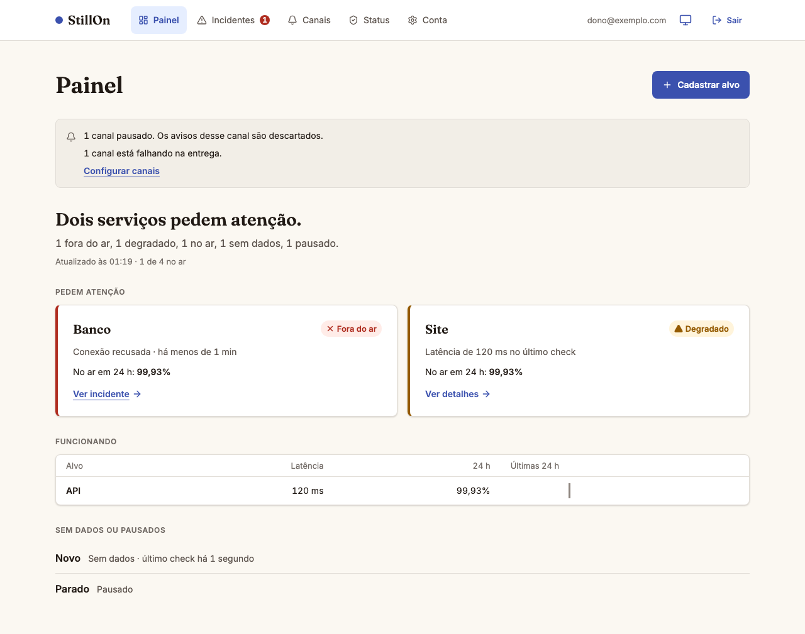
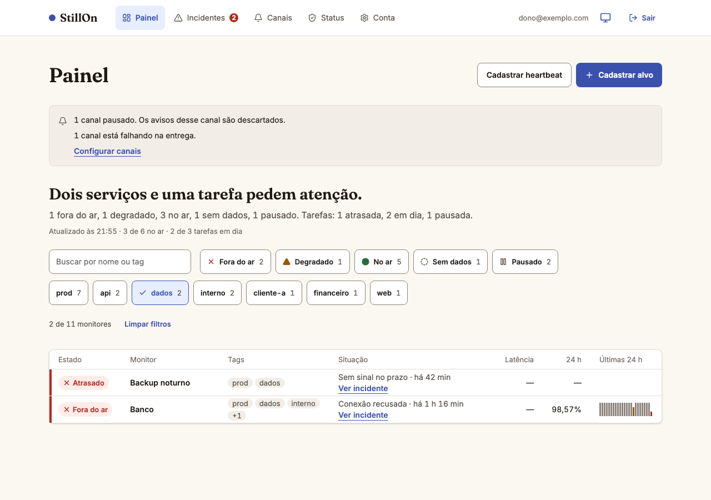
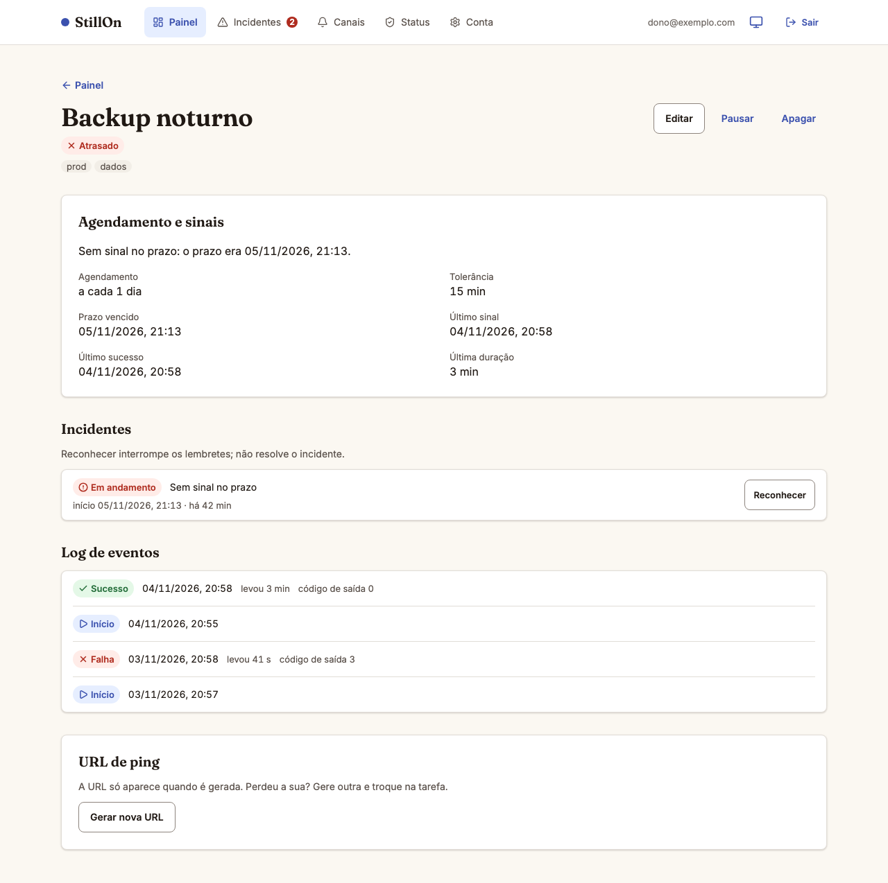
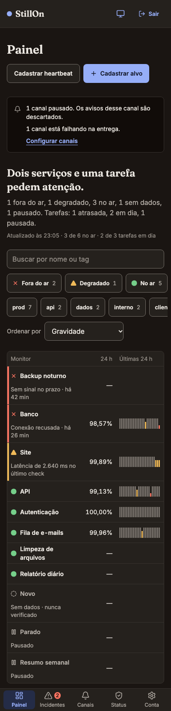
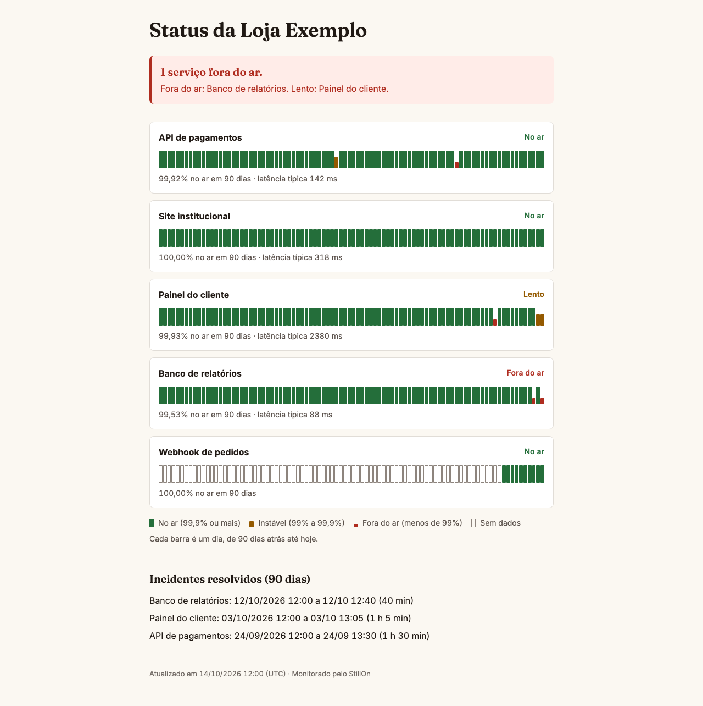
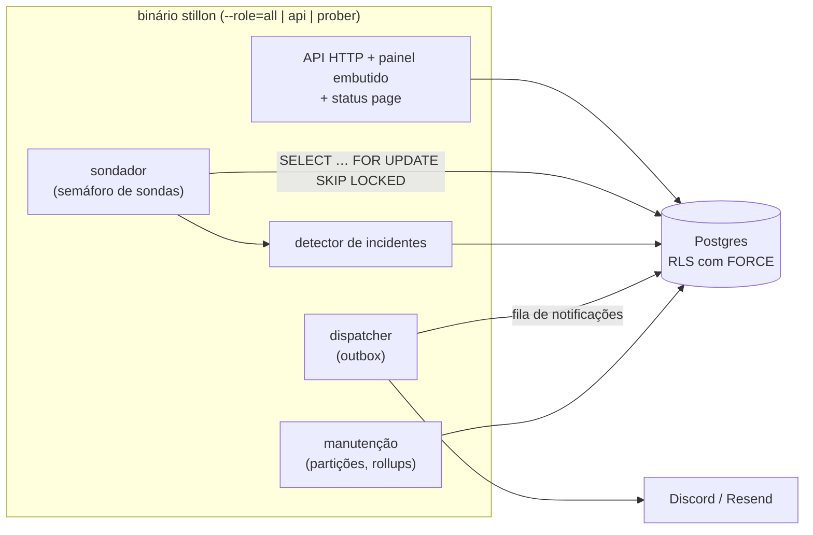

# StillOn (até 2026-09-25, Vigilume)

Monitor de disponibilidade de serviços HTTP: sonda cada alvo no intervalo que você define, abre e
fecha incidentes sozinho, avisa pelo Discord e por e-mail, e publica uma página de status. Um
binário Go com o painel React embutido e um Postgres. Ao vivo em <https://stillon.tech>.

[](https://github.com/BipoXDXD/stillon/actions/workflows/ci.yml)


## Rodar local

Precisa de Docker 25+ com Compose v2.20+ (o healthcheck usa `start_interval`).

```sh
git clone https://github.com/BipoXDXD/stillon.git && cd stillon
docker compose up --wait
```

Abra <http://localhost:8080> e entre com `demo@stillon.local` / `demo-stillon-2026`. O painel já
tem um alvo de exemplo, `https://example.com/` (domínio reservado para isso). Para cadastrar mais
no primeiro `up`: `DEMO_TARGETS_EXTRA="https://seu.site/ https://outro.site/" docker compose up --wait`.

- O repositório é público, mas o **pacote do GHCR segue privado**, e o compose
  **constrói do código** quando o pull é negado. Medido numa máquina de 16 núcleos: o build frio
  da imagem, num builder novo, levou ~34 s (provavelmente já contando o download das
  imagens-base); o `up --wait` levou ~4,5–5 s com as imagens prontas e ~8 s quando também
  construiu. Num notebook comum, o build demora mais. Depois
  que o job `publish` da `main` tiver rodado, quem tem acesso ao pacote pode puxar a imagem
  pronta (`docker login ghcr.io` com um token `read:packages`, depois `docker compose pull`).
- Use **`localhost`**, não o IP da máquina: o painel exige contexto seguro (HTTPS ou
  `localhost`). Em HTTP por outro endereço ele mostra um aviso e desliga a coordenação entre
  abas. A porta só escuta no `127.0.0.1`.
- Os alvos de exemplo precisam de internet. Um serviço rodando na sua máquina ou no próprio
  compose **não** pode ser alvo: o sondador recusa endereço privado, de propósito (SSRF, abaixo).
- As chaves do `compose.yaml` são de demonstração e estão no repositório. O boot valida a
  `PUBLIC_BASE_URL` (esquema `http` ou `https`, com host, sem usuário e senha) e só aceita essas
  chaves com `http` e host de loopback (`localhost` ou IP de loopback, como `127.0.0.1` e `::1`).
  Com `https` ele recusa sempre, até em `https://localhost`; com qualquer outro host, também. O
  boot só olha a URL **declarada**: o compose copiado para um servidor com um proxy na frente e a
  `PUBLIC_BASE_URL` ainda `http://localhost:8080` sobe com elas (ver abaixo).
- **O `compose.yaml` é só para a máquina local, nunca para servidor.** O usuário de
  demonstração tem senha pública, e o sistema é de um dono só: num servidor, ele seria o dono. O
  `seed` recusa rodar (sai com 1, e o `up` para) se a `PUBLIC_BASE_URL` não for `http` em
  `localhost` ou IP de loopback. **Isso não protege um servidor**: atrás de um proxy (um Caddy com
  `reverse_proxy app:8080`) e com a `PUBLIC_BASE_URL` ainda local, o seed e o boot aceitam, o
  usuário de demonstração nasce, e qualquer um entra com a senha pública. O app não confere o
  `Host` recebido. Para hospedar, use o compose de produção de [`deploy/vps/`](deploy/vps/), sem
  o `seed` e sem nenhuma chave ou senha do repositório. A produção de hoje o publica pelo Coolify
  (seção [Deploy e operação](#deploy-e-operação)); o [runbook](docs/deploy/vps.md) descreve a
  instalação anterior e abre com um aviso.

`docker compose down` para; `docker compose down -v` apaga o banco também.

## Verificar os canais de avisos

No painel, abra **Canais → Novo canal**. Esta verificação é do destino dos avisos,
independente do e-mail usado para entrar na conta.

- **Discord:** escolha Discord e cole a URL do webhook do canal do seu servidor.
  Ao cadastrar, o StillOn manda uma mensagem de teste; só marca **Verificado** se o
  Discord aceitar a entrega. O webhook precisa ser de um canal de texto, não de fórum.
  A URL fica no formulário do painel; não publique essa URL no chat ou no Git.
- **E-mail:** escolha E-mail e informe o endereço que receberá os avisos. Abra o link
  recebido e clique em **Confirmar**. O link vale por 24 horas; abrir a página sozinho
  não confirma o canal. Se vencer, use **Reenviar verificação** no painel.
  Apenas canais verificados e ativos recebem os avisos de incidentes.

### Habilitar e-mail na demonstração local

O envio de e-mail fica desligado por padrão. Para habilitar, primeiro guarde a chave
Resend no Bitwarden, na pasta **StillOn**. No seu computador, copie `.env.example`
para `.env`, restrinja a leitura com `chmod 600 .env` e preencha no editor local:

- `RESEND_API_KEY`: a chave do Resend guardada no Bitwarden.
- `EMAIL_FROM`: um remetente de domínio verificado no Resend, no formato
  `StillOn <alertas@seu-dominio>`.

As duas variáveis devem estar preenchidas juntas. O `.env` não vai para o Git nem
para a imagem Docker. Aplique a configuração ao serviço local:

```sh
docker compose up -d --no-deps --wait app
```

Depois, cadastre o canal de e-mail no painel. Na demonstração, o link recebido usa
`localhost` e deve ser aberto no mesmo computador que executa o StillOn. Em produção, as duas
variáveis são segredos de interpolação do recurso no Coolify, nunca arquivos do repositório
([`deploy/coolify/README.md`](deploy/coolify/README.md)).

## O que faz

- **Sonda** alvos HTTP (GET, HEAD ou POST) de 30 s a 24 h, com headers cifrados, status
  esperado, limite de latência para "degradado" e até 8 tags para agrupar e filtrar.
  Opcionalmente, uma **regra de conteúdo** (`content_rule`) julga os primeiros 64 KiB do corpo:
  `contains` e `not_contains` procuram um texto, e `json_equals` compara o escalar apontado por um
  ponteiro JSON (RFC 6901, como `/status`) com um valor. Regra reprovada é a causa
  `content_mismatch`; corpo numa codificação que o sondador não desfaz (br, zstd, deflate) é
  `content_encoding`; e corpo acima de 64 KiB sem conclusão é `body_limit`. A regra não aceita o
  método HEAD (não há corpo) nem os headers `Accept-Encoding` e `Range` do dono (o corpo chegaria
  comprimido ou cortado).
- **Certificado** do host cadastrado: o detalhe do alvo mostra a validade ("Certificado válido até
  …, em N dias", ou a data em que venceu), "não se aplica" para `http` ou IP literal e "aguardando a
  primeira sonda" antes da primeira leitura. Atrás de um balanceador com réplicas de certificados
  diferentes, a sonda guarda o pior certificado visto. Na API do alvo, `tls` traz `not_after` e
  `observed_at` (ou `null` sem leitura), e `tls_warn` é aceito no cadastro e no `PATCH` (padrão `true`).
- **Incidentes** abrem depois de falhas seguidas e fecham depois de sucessos seguidos, com
  histórico por alvo.
- **Notificações** pelo Discord e por e-mail (Resend), com entrega confiável: saem de uma fila
  no próprio Postgres e sobrevivem a um restart. Enquanto o incidente segue aberto e sem
  reconhecimento, cada canal recebe lembretes (Discord a cada 30 min e e-mail a cada 2 h nas
  primeiras 6 h; depois, a cada 6 h e 24 h). Reconhecer no painel interrompe os lembretes; o
  aviso de que o alvo voltou sai do mesmo jeito.
- **Heartbeats** para tarefas agendadas: a tarefa avisa por `POST` numa URL própria, com período e
  tolerância ou expressão cron com fuso explícito, sinais de início e falha, código de saída, tempo
  de execução, tags e log dos últimos eventos. O cadastro mostra os próximos disparos do cron antes
  de salvar. Sem aviso no prazo, abre incidente pelos mesmos canais. Passada a hora esperada, a
  tarefa fica **em tolerância** e o alarme só sai ao fim dela. O sufixo `/log` registra uma linha
  sem mexer no prazo (o conteúdo enviado não é guardado), e `?rid=` com um UUID identifica cada
  execução quando duas se sobrepõem. Com `ping_resumes` ligado, o primeiro sucesso religa uma
  tarefa pausada; o painel tem "Sinalizar agora" para registrar um sucesso à mão. Eles aparecem
  na tabela de monitores do painel, junto dos alvos, com a última duração, a execução em curso e
  os mesmos filtros. Período e tolerância vão até 365 dias, e a descrição até 10000 caracteres. A
  tarefa pode ser duplicada (`POST /api/v1/heartbeats/{id}/clone`): a cópia ganha o nome com
  " (cópia)" e sai sem token, eventos, estado nem incidentes da original; a URL de ping nova
  aparece uma vez só, a cópia conta no limite da conta, e um agendamento que esta versão não
  entende responde 409. O log de eventos pode ser limpo (`POST /api/v1/heartbeats/{id}/events/clear`,
  204), com registro em `audit_log` e sem mexer no prazo nem nos sinais. O diálogo da URL traz
  exemplos prontos para curl (com run id e `/log`), crontab, wget, Python e PowerShell, todos com
  `POST`.
  ```sh
  curl -fsS -m 10 --retry 3 -X POST https://stillon.tech/ping/SEU-TOKEN/start
  curl -fsS -m 10 --retry 3 -X POST https://stillon.tech/ping/SEU-TOKEN       # ou /fail
  backup.sh; curl -fsS -m 10 --retry 3 -X POST https://stillon.tech/ping/SEU-TOKEN/$?   # 0 é sucesso, o resto é falha
  ```
- **Página de status pública** em `/p/{slug}`, com os alvos que você escolher (tarefas de
  heartbeat não entram), uptime de 90 dias e os incidentes recentes.
- **Painel** com a frase de estado e os problemas primeiro, uma tabela só para alvos e tarefas
  com filtros por tag, estado e busca e ordem por gravidade, nome, menor tempo no ar ou maior
  latência (filtros e ordem ficam na URL), avisos de canais, navegação adaptada ao celular,
  gráfico de latência, 2FA (TOTP), sessões e troca de senha. Capturas na seção [Telas](#telas).

## Telas

O painel abre dizendo, numa frase, se algo está quebrado. Alvos e tarefas dividem uma tabela densa,
com os problemas primeiro e a cor, a forma e o texto do estado; tags, estado e busca filtram os dois,
e a ordem pode mudar para nome, menor tempo no ar ou maior latência.
Os mesmos tokens e fontes desenham a página pública.



| Filtro por tag | Tarefa: agendamento, duração e log |
|---|---|
|  |  |

| Celular, tema escuro | Página pública |
|---|---|
|  |  |

Todas as telas, a 400 e 1280 px e nos dois temas, ficam em
[`docs/design/painel-depois/`](docs/design/painel-depois/); o visual anterior, em
[`docs/design/painel-antes/`](docs/design/painel-antes/) e na tag `painel-antes-do-redesign`.
A versão com cartões, anterior à tabela densa, está na tag `painel-antes-do-denso`.
O roteiro que as gera é o `web/e2e/capturas.spec.ts` (só roda com `CAPTURAR=1`; o comando está
no comentário do arquivo).

## Arquitetura



Um processo só, que também roda partido (`--role=api` e `--role=prober`) sem mudar código: o
Postgres é a fila (`SKIP LOCKED`), então dois sondadores nunca pegam o mesmo alvo. Sem Redis nem
Kafka, porque o volume de um monitor destes cabe com folga no banco que já existe
([spec §17](docs/superpowers/specs/2026-09-22-stillon-design.md)).

## Decisões de segurança

| Decisão | Código | Teste que prova |
|---|---|---|
| SSRF: o IP é validado **na hora de conectar** (`ControlContext`), não só no cadastro, o que fecha o DNS rebinding; redirect revalidado a cada salto | [`safedial`](internal/prober/safedial/safedial.go), [`transport.go`](internal/prober/safedial/transport.go) | [`transport_test.go`](internal/prober/safedial/transport_test.go) (`TestRedirectToAnotherInternalAddressIsBlockedAtTheHop`) |
| Redirect para outro host/porta ou downgrade remove todos os headers personalizados, inclusive User-Agent; a identificação pública é recolocada e a cadeia que volta à origem permanece limpa. PATCH e redirect compartilham canonicalização IDNA | [`host.go`](internal/prober/safedial/host.go), [`transport.go`](internal/prober/safedial/transport.go) | [`probe_test.go`](internal/prober/probe_test.go) (`TestProbeRedirectDropsCustomUserAgentThroughoutAnUnsafeChain`), [`transport_test.go`](internal/prober/safedial/transport_test.go) |
| Isolamento por usuário com **RLS e `FORCE`**; o boot recusa um papel com superusuário ou `BYPASSRLS` | [`00004_targets_checks.sql`](internal/storage/migrations/00004_targets_checks.sql), [`role.go`](internal/storage/role.go) | [`rls_test.go`](internal/storage/rls_test.go) (`TestRLSIsolatesTargetsEvenWithTheWrongFilter`), [`role_test.go`](internal/storage/role_test.go) |
| Check infinito ou mais de um minuto à frente do relógio do banco é recusado antes de contaminar a histerese, inclusive por UPDATE e em partições novas; timestamps históricos finitos continuam permitidos | [`00010_checks_clock_guard.sql`](internal/storage/migrations/00010_checks_clock_guard.sql) | [`checkstime_test.go`](internal/storage/checkstime_test.go), [`future_check_test.go`](internal/prober/future_check_test.go) (`TestFutureCheckCannotPoisonIncidentHysteresis`) |
| Segredo e família da troca pendente de autenticador são ambos nulos ou ambos presentes; dados antigos inconsistentes recusam a migração, sem reparo automático | [`00011_totp_pending_pair.sql`](internal/storage/migrations/00011_totp_pending_pair.sql) | [`totppending_test.go`](internal/storage/totppending_test.go) (`TestTOTPPendingSecretAndFamilyMustStayTogether`) |
| Access token só em memória; refresh em cookie `HttpOnly`, `SameSite=Strict`, com rotação e detecção de reúso que derruba a família | [`authhandlers.go`](internal/httpapi/authhandlers.go), [`sessao.ts`](web/src/lib/api/sessao.ts) | [`auth_integration_test.go`](internal/httpapi/auth_integration_test.go) (`TestReusedRefreshCookieRevokesTheWholeFamily`) |
| Recursos exigem família de sessão viva, além do JWT válido: revogar bloqueia novas requisições; falha na consulta recusa o acesso. Operações já admitidas podem concluir | [`routes.go`](internal/httpapi/routes.go), [`accounthandlers.go`](internal/httpapi/accounthandlers.go) | [`recursos_sessao_viva_integration_test.go`](internal/httpapi/recursos_sessao_viva_integration_test.go), [`sessao_viva_wiring_internal_test.go`](internal/httpapi/sessao_viva_wiring_internal_test.go) |
| Segredos com AES-256-GCM e o id da linha como AAD (um texto cifrado não muda de linha); tipo `Secret` que não sai em log nem em JSON | [`box.go`](internal/crypto/box.go), [`secret.go`](internal/crypto/secret.go) | [`box_test.go`](internal/crypto/box_test.go) (`TestOpenRejectsCiphertextMovedToAnotherRow`), [`secret_test.go`](internal/crypto/secret_test.go) |
| Chaves de demonstração do compose aceitas no boot só com `PUBLIC_BASE_URL` `http` em `localhost` ou IP de loopback; `https` recusado sempre, em qualquer host; URL malformada ou com usuário e senha recusada | [`config.go`](internal/config/config.go) | [`config_test.go`](internal/config/config_test.go) (`TestLoadRejectsDemoKeysOverHTTPS`, `TestLoadRejectsDemoKeysOnANonLoopbackHost`, `TestLoadAcceptsDemoKeysOnLoopback`, `TestLoadRejectsMalformedPublicBaseURL`), [`compose_test.go`](internal/config/compose_test.go) (`TestComposeUsesTheDemoKeys`) |
| Ping de heartbeat com token de 256 bits guardado só como SHA-256; inexistente, revogado e malformado respondem igual; o escopo do ping enxerga só a linha do token e nenhum incidente; o token nunca vai para log; limite por IP folgado para NAT e limite por token; repetição sem efeito; o binário anterior ignora as linhas de heartbeat num rollback | [`pinghandlers.go`](internal/httpapi/pinghandlers.go), [`00016_heartbeats.sql`](internal/storage/migrations/00016_heartbeats.sql), [spec](docs/superpowers/specs/2026-11-05-heartbeats-design.md) | [`ping_integration_test.go`](internal/httpapi/ping_integration_test.go), [`heartbeat_rls_test.go`](internal/storage/heartbeat_rls_test.go), [`heartbeat_rollback_test.go`](internal/storage/heartbeat_rollback_test.go) (`TestOlderBinaryIgnoresHeartbeatRows`) |
| Status page com DTO próprio: nada interno chega à página pública | [`public.go`](internal/statuspage/public.go) | [`public_test.go`](internal/statuspage/public_test.go) (`TestPublicViewHasNoInternalFields`) |
| IP real do cliente atrás do proxy, com falha **fechada**: o `X-Forwarded-For` (ou o cabeçalho de `CLIENT_IP_HEADER`) só vale vindo de `TRUSTED_PROXIES`, e um prefixo `/0` ali é recusado no boot. `CLIENT_IP_HEADER` só serve atrás de proxy que **substitui** esse cabeçalho; atrás do Caddy da produção ele fica **vazio**, o `TRUSTED_PROXIES` é o IP fixo do Caddy na rede do compose, e vale o último salto do `X-Forwarded-For`, com todas as linhas lidas juntas. O Caddy remove `X-Real-IP`, `Fly-Client-IP` e `CF-Connecting-IP` vindos do cliente. Com `PUBLIC_BASE_URL` https, um `X-Forwarded-For` de fora de `TRUSTED_PROXIES` vira aviso no log (um por minuto, com o `remote_addr`). Atrás da Cloudflare, o IP do cliente vem do `CF-Connecting-IP`, aceito só de conexões nas faixas dela | [`clientip.go`](internal/httpapi/middleware/clientip.go) | [`clientip_test.go`](internal/httpapi/middleware/clientip_test.go) (`TestRateLimitSeparatesClientsBehindFly`, `TestClientIPJoinsEveryForwardedForLine`), [`auth_integration_test.go`](internal/httpapi/auth_integration_test.go) (`TestSessionsBehindFlyRecordDistinctOrigins`), [`clientip_internal_test.go`](internal/httpapi/middleware/clientip_internal_test.go) (`TestForwardedForFromOutsideTheListWarnsInProduction`), [`config_test.go`](internal/config/config_test.go) (`TestLoadRejectsAZeroBitTrustedProxy`) |
| Argon2id com teto de concorrência: toda verificação e todo hash (inclusive o do e-mail inexistente) passam por um semáforo de `min(NumCPU, 4)` vagas (`ARGON2_MAX_CONCURRENT`, 1–64); sem vaga em 2 s, `429 rate_limited` com `Retry-After: 2`, em vez de o processo morrer sem memória | [`argon2.go`](internal/auth/argon2.go) | [`argon2_test.go`](internal/auth/argon2_test.go) (`TestEveryArgon2PathWaitsForASlot`), [`argon2_integration_test.go`](internal/httpapi/argon2_integration_test.go) (`TestSaturatedArgon2AnswersRateLimited`) |
| Na troca de senha, o hash novo termina antes de consumir TOTP/recovery: saturação desse hash devolve 429 e preserva o código | [`account.go`](internal/account/account.go) | [`account_test.go`](internal/account/account_test.go) (`TestChangePasswordKeepsRecoveryCodeWhenTheNewHashIsRateLimited`) |
| API e verificação propagam prazo de trabalho de 15 s, abaixo do timeout de escrita: SQL e espera no pool são cancelados; erro interno por prazo vencido usa `503 unavailable` com trace. A projeção pública preserva seu worker compartilhado de até 5 s | [`deadline.go`](internal/httpapi/middleware/deadline.go), [`routes.go`](internal/httpapi/routes.go) | [`deadline_integration_test.go`](internal/httpapi/deadline_integration_test.go) (travas e pool reais; nenhuma criação após vencer) |
| Bloqueio de conta atômico (a tentativa é reservada **antes** do Argon2 ou do TOTP: N requisições paralelas gastam N tentativas) e sem negação de serviço ao dono: um login completo deixa o cookie de dispositivo `stillon_dispositivo`, e quem o apresenta não é barrado pelo bloqueio que um anônimo provocou; nas rotas autenticadas, a 5ª prova errada revoga a família da sessão | [`user.go`](internal/auth/user.go), [`dispositivo.go`](internal/auth/dispositivo.go), [`provas.go`](internal/auth/provas.go), [`provas.go` (httpapi)](internal/httpapi/provas.go) | [`user_test.go`](internal/auth/user_test.go) (`TestConcurrentReservationsStopAtTheThreshold`), [`dispositivo_integration_test.go`](internal/httpapi/dispositivo_integration_test.go) (`TestParallelLoginGuessesStopAtTheLock`, `TestDeviceCookieLetsTheOwnerInPastTheAccountLock`), [`dispositivo_revogacao_integration_test.go`](internal/httpapi/dispositivo_revogacao_integration_test.go) (`TestDeviceCookieDiesWithTheCredentials`), [`provas_familia_integration_test.go`](internal/httpapi/provas_familia_integration_test.go) (`TestFifthWrongProofDropsTheFamily`) |
| O `seed` do compose recusa `PUBLIC_BASE_URL` fora de `http` em loopback, antes de chamar o binário. Isso **não** protege um servidor: atrás de um proxy e com a URL ainda local, ele roda e o usuário de demonstração nasce. O `compose.yaml` é só para a máquina local; para hospedar, o compose de produção de `deploy/vps/`, sem o `seed` | [`seed.sh`](deploy/compose/seed.sh) | [`seed_test.go`](internal/config/seed_test.go) (`TestSeedRefusesOutsideLoopback`), [`compose_test.go`](internal/config/compose_test.go) (`TestComposeHeaderSaysItIsLocalOnly`) |
| Produção com a Cloudflare e o proxy do Coolify na frente: o StillOn não publica porta nenhuma; o Caddy do StillOn só confia no `X-Forwarded-For` do proxy da frente (IP fixo, modo estrito), fala com o app pelo IP fixo e só aceita o domínio, direto ou pelo proxy; `X-Real-IP`, `Fly-Client-IP` e `CF-Connecting-IP` mandados pelo cliente são removidos; o banco não aceita conexão de fora da rede do compose; rede sem IPv6 | [`compose.prod.yaml`](deploy/vps/compose.prod.yaml), [`Caddyfile`](deploy/vps/Caddyfile), [`app.json`](deploy/coolify/app.json), [`database.json`](deploy/coolify/database.json) | [`checar-vps.sh`](deploy/ci/checar-vps.sh) (job `vps` do CI: o compose de produção atrás de uma borda de teste igual ao contrato; blocos 1 a 7, inclusive um vizinho na rede da borda forjando IP, chamado `app` ou mandando outro `Host`) e [`checar-borda-cloudflare.sh`](deploy/ci/checar-borda-cloudflare.sh) (mesmo job: uma cadeia de teste com a Cloudflare simulada; cada cliente tem o seu balde de login e de ping, e o `CF-Connecting-IP` forjado, inválido ou duplicado não vale) |
| **Limite conhecido:** a Cloudflare fica na frente de `stillon.tech` e termina o TLS, então vê em claro o que passa por ali, por exemplo: senha no login, cookies de sessão, tokens de ping e de verificação. As proteções acima valem daí em diante, não antes dela. O proxy da frente a trata como proxy confiável só nas faixas oficiais dela; o que ela vê em claro não muda | [STRIDE do ping](docs/superpowers/specs/2026-11-05-heartbeats-design.md), D10 da [auditoria](docs/superpowers/reports/2026-11-05-auditoria-refatoracao.md) | Nenhum: a borda não é testável daqui |
| Release pelo Coolify: só publica o SHA de um push na `main` cujo `ci` terminou com sucesso, com todos os jobs obrigatórios (commit `[skip ci]` não publica); imagens em OCI por SSH, com digest e plataforma conferidos, para uma entrada restrita ao projeto; o receptor verifica a propriedade e a imagem em execução e só registra sucesso após saúde real; a chave fica no environment `production`, que aceita só a `main` | [`coolify.yml`](.github/workflows/coolify.yml), [`gate.py`](deploy/coolify/release/gate.py), [`receiver.py`](deploy/coolify/release/receiver.py) | [`test_gate.py`](deploy/coolify/release/test_gate.py), [`test_receiver.py`](deploy/coolify/release/test_receiver.py) (rodam no `coolify.yml` em todo PR que mexe nele, no `ci.yml` ou em `deploy/coolify/release/`) |
| Caminho anterior (o `deploy.yml`, hoje desativado no GitHub): deploy por uma chave SSH que só roda um script: verbo desconhecido, SHA malformado, imagem divergente e o SHA no ar (ou o anterior) já etiquetado com outra imagem recusados; rollback automático se a versão nova não ficar saudável; o backup só devolve texto cifrado | [`stillon-entrada`](deploy/vps/stillon-entrada) | [`checar-vps.sh`](deploy/ci/checar-vps.sh), blocos 2, 8 (recusas, imagem divergente, rollback, store, `sudoers`) e 9 (backup) |
| Caminho anterior: SSH real com chave restrita e sudoers de produção: pedido, códigos e bytes nos dois sentidos; host key divergente, PTY e comando arbitrário recusados. Entrada remota simulada; não substitui o deploy guiado | [`testar-ssh-real.sh`](deploy/ci/testar-ssh-real.sh), [`ssh/`](deploy/ci/ssh/) | `bash deploy/ci/testar-ssh-real.sh` (contêineres e chaves efêmeros, RED/restauração/GREEN) |
| Senhas do PostgreSQL fora de argv no initdb e backup; psql cita os literais importados do ambiente. Instalação npm sem hooks no Dockerfile e CI | [`initdb.sh`](deploy/vps/initdb.sh), [`backup.sh`](deploy/backup/backup.sh), [`Dockerfile`](Dockerfile) | [`scripts_test.go`](internal/config/scripts_test.go), build real com `npm ci --ignore-scripts` |
| Backup usa o mesmo snapshot para referência e dump; supervisor coleta clientes, limita a execução e recusa parâmetros que alterem suas proteções. Helper copiado da imagem app por ID imutável, executado sem root/capabilities no PG descartável | [`backup/`](internal/backup/), [`backup.sh`](deploy/backup/backup.sh), [`stillon-entrada`](deploy/vps/stillon-entrada) | [`backup_snapshot_test.go`](internal/config/backup_snapshot_test.go) (Postgres real, concorrência, SCRAM, RLS e interrupções), [`checar-vps.sh`](deploy/ci/checar-vps.sh) (distribuição, recuperação e terceiros preservados) |
| Mutação exige valor literal `stillon` no header customizado; valor é contrato público e nome segue a semântica HTTP. GET/HEAD/OPTIONS permanecem permitidos | [`csrf.go`](internal/httpapi/middleware/csrf.go) | [`middleware_test.go`](internal/httpapi/middleware/middleware_test.go), [`auth_integration_test.go`](internal/httpapi/auth_integration_test.go) (403 na guarda e controle 401 do login real) |
| CSP com nonce por resposta, no painel e na status page | [`webui.go`](internal/webui/webui.go), [`publicpage.go`](internal/httpapi/publicpage.go) | [`publicpage_integration_test.go`](internal/httpapi/publicpage_integration_test.go) (`TestPublicPageRendersWithoutLeaking`); E2E: [`fluxo.spec.ts`](web/e2e/fluxo.spec.ts) (zero violações, com controle positivo) |
| Imagem distroless **nonroot, sem shell**, Trivy sem achado HIGH/CRITICAL corrigível, varredura de segredos (gitleaks) no histórico inteiro em todo PR | [`Dockerfile`](Dockerfile), [`ci.yml`](.github/workflows/ci.yml), [`.gitleaks.toml`](.gitleaks.toml) | [`checar-imagem.sh`](deploy/ci/checar-imagem.sh) |
| Versão nova de dependência Go ou npm espera 7 dias antes de entrar no PR do Dependabot (as atualizações de segurança não esperam); a chave privada do `age` e os dumps do backup não entram no git | [`dependabot.yml`](.github/dependabot.yml), [`.gitignore`](.gitignore) | [`repositorio_test.go`](internal/config/repositorio_test.go) (`TestDependabotWaitsSevenDaysForGoAndNpm`, `TestGitignoreCoversTheBackupKeyAndDumps`) |

## Concorrência

- O sondador reivindica só o que cabe no [semáforo](internal/prober/scheduler.go) e devolve a
  vaga até em panic (`TestProbePanicIsLoggedAndReturnsTheSlot`).
- Cada subsistema roda num [`errgroup`](cmd/stillon/main.go): se um cai, os outros encerram, e o
  processo sai com erro em vez de ficar meio vivo. Shutdown gracioso com prazo de 15 s, e sondas
  interrompidas não viram falso "fora do ar".
- No painel, o refresh do token é *single-flight* e coordenado entre abas por Web Locks
  ([`sessao.ts`](web/src/lib/api/sessao.ts)); duas abas recarregando juntas não derrubam a sessão
  ([`abas.spec.ts`](web/e2e/abas.spec.ts)).

## Testes

```sh
make test          # testes do docker-build.sh (Python) e Go com -race; precisa de Docker (Postgres real via testcontainers)
make test-short    # sem Docker
cd web && npm test # Vitest do painel
make e2e           # APAGA o banco do compose, sobe com --build, confere e roda o Playwright
```

- **Sem mock de banco**: RLS, `SKIP LOCKED`, partições e advisory locks só se provam num
  Postgres de verdade. O CI roda a suíte no **17 e no 18**, cada um fixado por digest.
- O **E2E** (Playwright, Chromium) roda no CI contra o **mesmo `compose.yaml`** deste README, com a
  imagem que acabou de passar no Trivy: o "sobe com um comando" é teste de regressão. As specs
  rodam em série. O fluxo principal espera ~21 s antes de começar, para os limitadores de
  requisição (login e por usuário) encherem de novo depois das specs anteriores, e a limpeza do
  fim, que roda com os baldes gastos, repete com recuo (até ~30 s) quando leva um 429.
- O **backup** de produção tem workflow próprio que restaura o dump num banco descartável e o
  confere; ele roda todo dia, ligado em 2026-10-14 com `BACKUP_ENABLED=1`. Os artifacts são
  públicos (o repositório é público), mas cifrados com `age`: a decisão está no
  [runbook](docs/deploy/vps.md), seção "Tornar o repositório público".
- **Prova por sabotagem.** Todo teste que afirma uma ausência ("o segredo não vaza", "o cliente
  não alcança") é conferido quebrando a propriedade de propósito e vendo ficar vermelho. Um caso
  real: os testes de middleware montavam a cadeia à mão, e apagar `SecurityHeaders`, `CORS` e
  `BodyLimit` de `routes.go` deixava a suíte verde; daí nasceu
  `TestTheMiddlewareChainIsActuallyWired`.

## Stack

| Camada | Escolha |
|---|---|
| Backend | Go 1.26, `net/http`, pgx, sqlc, goose, `log/slog`, Prometheus |
| Banco | PostgreSQL 18 (compatível com o 17) |
| Painel | React 19, TypeScript, Vite, TanStack Query, React Router, React Hook Form + Zod, Radix, Tailwind, Recharts |
| Testes | `testing` + testcontainers, Vitest + Testing Library + MSW, Playwright + axe |
| Entrega | Docker (distroless), GitHub Actions, GHCR, Coolify numa VPS (Hostinger), Caddy, Cloudflare na frente |

## Desenvolvimento

```sh
make build            # bin/stillon, com a versão do git describe
make generate         # sqlc generate, depois de mudar internal/storage/queries
make lint sec         # vet, staticcheck, gosec, govulncheck (instalados no PATH)
make image            # a imagem de produção
make up               # docker compose up --wait --build: o compose com o código que você tem
cd web && npm run dev # o painel em http://localhost:5173, com proxy de /api para :8080
```

Depois de mudar o código, `docker compose up --build` (ou `make up`): sem o `--build`, o compose
reusa a imagem que já tem. Para o `npm run dev`, suba a API pelo compose (o `CORS_ORIGIN` do
compose já é o do Vite). Criar ou recuperar o usuário dono: `stillon user create --email <e>` e
`stillon user set-password --email <e>`, com a senha pelo stdin. Quem perdeu o autenticador **e**
os códigos de recuperação: `stillon user reset-2fa --email <e>` desliga o 2FA, zera o bloqueio da
conta e encerra todas as sessões (não pede senha: só lê a `DATABASE_URL`); depois, entre com a senha e ative de novo pelo
painel. Sem 2FA ligado, o comando diz "nada mudou" e não mexe em nada, **nem no bloqueio**: para
destravar uma conta sem 2FA, use o `set-password`.

Fora do compose (`make run`, ou o `bin/stillon` direto), o boot exige `DATABASE_URL`,
`PUBLIC_BASE_URL`, `CORS_ORIGIN` e as chaves `MASTER_KEY`, `JWT_SECRET` e `IP_HASH_KEY` (base64);
o bloco `x-ambiente` do [`compose.yaml`](compose.yaml) mostra o formato de cada uma.

Para rodar a API e o sondador separados no mesmo host (`--role=api` e `--role=prober`), não
precisa configurar nada: sem `METRICS_ADDR`, a porta de métricas é `127.0.0.1:9090` para `api` e
`all` e `127.0.0.1:9091` para `prober`.

## API

REST sob `/api/v1`, usada pelo painel (a [spec, §9](docs/superpowers/specs/2026-09-22-stillon-design.md)
tem as convenções). Todo erro, inclusive rota ou método inexistente sob `/api/`, vem no envelope
`{"error": {"code", "message"}, "trace_id"}`; o `code` é o contrato, a `message` é para gente.

- `401 unauthorized` é só token recusado (ausente, inválido, vencido, de família morta): o
  cliente renova a sessão. `401 invalid_credentials` é senha ou código errado: não renova.
- `429 rate_limited` vem dos limitadores por IP e por usuário (com `Retry-After` desde o #77) e, desde o
  Plano 10, do teto de concorrência do Argon2id (com `Retry-After: 2`).
- Mutação exige o cabeçalho `X-Requested-With: stillon`, com esse valor literal
  sensível a caixa. O valor é público; a defesa contra CSRF depende também de
  CORS/preflight e cookies. Outro valor recebe 403.

- Nos `PATCH` de alvo, heartbeat e página de status, campo ausente fica como está. `null` em campo
  obrigatório é `400 validation_failed`, com cada campo em `fields` como `required`, sem gravar nada,
  nem o que veio junto, e antes de procurar o recurso: `name`, `url`, `method`, `interval_sec`,
  `timeout_ms`, `expected_status`, `enabled`, `schedule`, `grace_sec`, `slug`, `title`, `published` e
  `items`. Até 2026-11, `null` nesses campos valia como ausente (`name` mudou no #194). `null` limpa
  `tags`, `description` e `headers`, e em `degraded_threshold_ms` desliga a classificação `degraded`.
  No `PATCH /channels/{id}`, `enabled: null` é `400` com `invalid`.
- Piso de rollback dos heartbeats: esta versão tolera linhas gravadas por uma versão posterior com
  um agendamento que ela não entende. Na saída, o heartbeat vem com `"schedule": {"kind": "unknown"}`,
  sem outros campos; o `PATCH` é recusado com `409 schedule_unsupported`, sem gravar nada (`DELETE`
  e rotação de token seguem); o ping é aceito e registrado sem mexer no prazo; e o avaliador ignora
  o prazo dessas linhas. A falha avisada (`/fail` ou código de saída diferente de zero) continua
  abrindo o incidente `heartbeat_failed`, e o sucesso seguinte o fecha.

O que mudou no Plano 10 (spec do Plano 10, §4):

| Rota | Antes | Agora |
|---|---|---|
| `POST /auth/login`, `/auth/password`, `/auth/totp/enroll`, `/auth/totp/disable`, `/auth/totp/rotate` (as que pagam Argon2id) | — | `429 rate_limited` com `Retry-After: 2` quando o Argon2id não tem vaga em 2 s |
| Rotas autenticadas de credencial (`/auth/password`, `/auth/totp/enroll`, `confirm`, `disable`, `rotate`, `rotate/confirm`) | conta bloqueada → `401 invalid_credentials` | não olham o bloqueio da conta; a 5ª prova errada na mesma família de sessão (as seis rotas dividem o contador) revoga a família e responde `401 unauthorized`; da 1ª à 4ª, a resposta de sempre (`401 invalid_credentials`; `400 validation_failed` no `confirm`, que antes não contava falha); com o 2FA ligado, o `confirm` e o `enroll` respondem `403 forbidden` sem conferir o código e sem zerar o contador (só a prova do fator o zera) |
| `POST /auth/totp/rotate` | `{"otpauth_uri"}` | mais `"rotation"` (32 caracteres hexadecimais) |
| `POST /auth/totp/rotate/confirm` | `{"code"}` | `{"code", "rotation"}`; `rotation` ausente ou diferente do da troca em andamento → `403 forbidden`, antes do código e sem contar falha |
| `POST /auth/logout` | `204` mesmo com a revogação falhando | `500 internal` sem apagar o cookie, para tentar de novo |
| Rotas do TOTP com o usuário apagado no meio | `500 internal` | `401 unauthorized` |
| `PATCH /targets/{id}` que muda esquema, host ou porta da URL sem mandar `headers` | mantinha os headers | apaga os headers (`"header_names": []`); mudar só o caminho mantém |
| `POST` e `PATCH /targets` com `expected_status` 1xx ou 3xx | aceito (o alvo ficava `down` para sempre) | `400 validation_failed`, `out_of_range` |
| 404 e 405 sob `/api/` | texto puro do `net/http` | envelope: `404 not_found` e `405 method_not_allowed` (código novo) |
| `GET /targets/{id}/checks` | o painel mandava `from` calculado com o relógio do navegador | `?window=1h\|6h\|24h\|7d\|30d\|90d`: o servidor calcula `from = to − janela` com o relógio dele; `window` vazio, fora da lista ou junto com `from` → `400 validation_failed` (`window`/`invalid`); `from`/`to` sem `window` continuam valendo |
| Login completo (senha e, se ligado, 2FA) | — | cookie `stillon_dispositivo` (`HttpOnly`, `SameSite=Strict`, `Path=/api/v1/auth`, 180 dias; `Secure` com `PUBLIC_BASE_URL` https), que dispensa o bloqueio da conta no login e no `/totp/verify`; morre com a troca de senha, o `set-password`, o `reset-2fa` e a ativação ou o disable do 2FA (o MAC cobre o hash da senha e a data de ativação do 2FA) |

## Deploy e operação

Uma VPS na Hostinger, gerida pelo Coolify e dividida com outros projetos do dono.
Na frente de `stillon.tech` ficam a Cloudflare e o proxy do Coolify. O StillOn tem três contêineres:
o **Caddy** do projeto (só HTTP e só para o domínio), o **binário** (`--role=all`) e o **Postgres 18**,
com a imagem oficial fixada por digest. Nenhum publica porta: só o Caddy fica na rede do proxy, e o
app e o banco ficam na rede interna.
Aplicação e banco são dois recursos do Coolify, para que publicar o app não pare o banco
([`app.json`](deploy/coolify/app.json), [`database.json`](deploy/coolify/database.json) e a
[nota sobre o Coolify](deploy/coolify/README.md)); o
[`compose.prod.yaml`](deploy/vps/compose.prod.yaml) é a definição equivalente num arquivo só, que
o job `vps` do CI exercita.
Os segredos são variáveis privadas do recurso no Coolify, com cópia no gerenciador de senhas do
dono.

- **Imagem:** ~7,6 MB comprimida. A de produção sai do mesmo código e das mesmas bases fixadas
  por digest que o E2E testou, mas é construída de novo no `publish` (amd64 e arm64) e
  **reescaneada** pelo Trivy antes de ganhar as tags `:<sha do commit>` e `:latest`.
- **Deploy:** todo merge na `main` publica sozinho. Quando o `ci` de um push na `main` termina com
  sucesso, o workflow `Coolify release` confere o SHA exato e os gates, envia as imagens por SSH a
  uma entrada restrita na VPS e atualiza a imagem do recurso no Coolify
  ([detalhes](deploy/coolify/release/README.md)). O release só troca imagens: a configuração dos
  contêineres fica no commit de infraestrutura fixado no Coolify, então uma mudança em
  `deploy/vps/Caddyfile` ou nos tetos de recurso só chega à produção quando esse commit é
  atualizado no recurso. Commit com `[skip ci]` não publica: é o caminho da documentação. O
  environment `production` aceita só a `main` e não tem revisor (decisão pendente do dono): a `main`
  exige PR e checks, e publicar depende de quem tem acesso de escrita ao repositório (hoje, só o
  dono). O `deploy.yml` manual, por SHA e pela [`stillon-entrada`](deploy/vps/stillon-entrada),
  era o caminho anterior: o arquivo segue no repositório, mas o workflow está desativado.
- **Cloudflare:** ela termina o TLS e vê em claro o que passa por ali (veja o limite conhecido em
  "Decisões de segurança").
- **Backup:** dump lógico diário, feito na VPS e restaurado num banco descartável e conferido
  (dono das tabelas, RLS com `FORCE`, contagens, partições) antes de sair **já cifrado** com
  `age` (a chave privada fica com o dono e num secret de environment, fora da VPS) para um
  artifact de 30 dias. O ensaio diário do [`revalidar-backup`](.github/workflows/revalidar-backup.yml)
  restaura o artifact guardado num Postgres sem rede. Ele depende de o environment da chave aceitar
  a `main`: esse environment tem de aceitá-la, e até lá o ensaio falha. Quando falha, abre uma issue
  para o dono, que fecha sozinha quando o ensaio volta a passar. Uma checagem que falha
  sai com código 3; disco com 85% ou mais sai com 4 (o dump é guardado mesmo assim, e o job fica
  vermelho). Referência e dump usam snapshot comum; a fase supervisionada tem orçamento de
  600 s, além da graça de encerramento. Isso não limita todo o restauro nem substitui PITR.
  Atualizar imagem e scripts juntos: imagem sem o protocolo novo é recusada antes da origem.
  [Provas locais e limites](docs/superpowers/reports/2026-10-04-segunda-onda.md).
  Por cima, o backup semanal da Hostinger.
- **Vigia externo:** um timer da VPS ([`stillon-vigia`](deploy/vps/stillon-vigia.timer)) consulta o
  `/healthz` público a cada minuto e pinga o healthchecks.io, que avisa o dono por e-mail se o
  site cair ou a VPS sumir: o StillOn não consegue avisar da própria queda. Como o pedido passa
  pela Cloudflare, um problema entre ela e a origem aparece como queda.

Operação: [`deploy/coolify/README.md`](deploy/coolify/README.md) (publicação, banco e limites de
recurso) e [`deploy/coolify/release/README.md`](deploy/coolify/release/README.md) (o release). O
[`docs/deploy/vps.md`](docs/deploy/vps.md) é o runbook manual da **instalação anterior**, do "VPS
recém-criada" ao "no ar com 2FA, e-mail, backup e vigia": não rode os comandos dele na produção
atual.

## O que ficou de fora, e por quê

- **Vários usuários, times e planos**: dobraria o prazo sem somar sinal técnico novo. É um
  sistema de um dono; a RLS isola por usuário mesmo assim.
- **Sondas TCP, ICMP e DNS, e de várias regiões**: HTTP já exercita o pipeline inteiro; várias
  regiões exigem infraestrutura distribuída.
- **Slack, Telegram, webhook genérico**: dois canais já provam a abstração de notificação.
- **SSE ou WebSocket no painel**: o painel consulta de tempos em tempos, e isso basta.
- **Domínio próprio na status page**: verificação de DNS é escopo próprio.
- **Réplica, failover e PITR do Postgres**: um nó com o dump diário conferido e cifrado, mais o
  backup semanal da VPS inteira na Hostinger, basta para este volume; no pior caso, perde-se um
  dia de checks.
- **Métricas raspadas em produção**: exigiriam um coletor na VPS; em produção,
  `METRICS_ADDR=off`.
- **Cotas por usuário no sondador e no despacho**: só o operador cria contas (pelo CLI), então
  quem as esgotaria é uma conta que o próprio dono criou. Volta à mesa se o cadastro abrir.

Os motivos completos estão na [spec](docs/superpowers/specs/2026-09-22-stillon-design.md) (§2.2)
e no histórico dos planos (abaixo).

## Histórico

- Até 2026-09-25 o projeto tinha o nome antigo que o título registra; nessa data passou a se
  chamar StillOn.
- Nessa data foram apagados do repositório os planos 1 a 11, as specs de cada plano, os
  relatórios de revisão e as pendências antigas. Ficaram a
  [spec do sistema](docs/superpowers/specs/2026-09-22-stillon-design.md), o
  [roteiro](docs/superpowers/plans/2026-09-22-roadmap.md), o
  [contrato dos Planos 5, 6 e 7](docs/superpowers/specs/2026-09-24-planos-5-6-7-contrato.md) e as
  [pendências correntes](docs/superpowers/PENDENCIAS-PARA-O-PLANO-12.md).
- Para ler um arquivo apagado, use o commit `2e1c3ce7d816a0ccdb144ab3057878a4c66255a9`, o último
  que os tem:
  ```bash
  git ls-tree -r --name-only 2e1c3ce7d816a0ccdb144ab3057878a4c66255a9 docs/superpowers   # a lista
  ARQUIVO=docs/superpowers/plans/...   # troque os ... por um nome da lista
  git show "2e1c3ce7d816a0ccdb144ab3057878a4c66255a9:$ARQUIVO"
  ```
- O plano da própria renomeação não está nesse commit: foi apagado no PR que a fez (#20). Leia-o
  com `git show 24dda3f:docs/superpowers/plans/2026-09-25-renomeacao-stillon.md`.
- Os comentários do código citam decisões por identificador ("D32 do Plano 7", "spec do Plano 10,
  §4", "banco S1 da revisão"), que se resolvem nesses arquivos. "spec §N" sem número de plano é a
  spec do sistema, `docs/superpowers/specs/2026-09-22-stillon-design.md`, que continua aqui.

## Licença

MIT, veja [LICENSE](LICENSE).

## Builds Docker e arquitetura

Use `make image` para construir e verificar imagens **nativas do daemon Docker ativo**.
O comando ignora uma seleção antiga em `DOCKER_DEFAULT_PLATFORM`; não fixa o projeto em AMD64 ou ARM64.

`make image-release` exporta arquivos em `.docker-artifacts/` com **linux/amd64 e linux/arm64**,
sem carregar uma imagem estrangeira sobre a tag local. `VERSION=...` escolhe a tag dos artefatos.

Para builds personalizados, use `scripts/docker-build.sh local -f CAMINHO -t IMAGEM CONTEXTO`.
Para publicar quando autorizado, use `scripts/docker-build.sh publish -f CAMINHO -t REGISTRY/IMAGEM CONTEXTO`;
o comando verifica as duas plataformas no registry. Não substitua estes comandos por um build
AMD64 com `--load` no Mac: para uma entrega offline, use o modo `oci ARQUIVO.tar`.
A verificação isolada é `scripts/docker-build.sh check IMAGEM` (local) ou `published REGISTRY/IMAGEM` (release).
Para a pilha local, `make up` também seleciona a arquitetura nativa.
