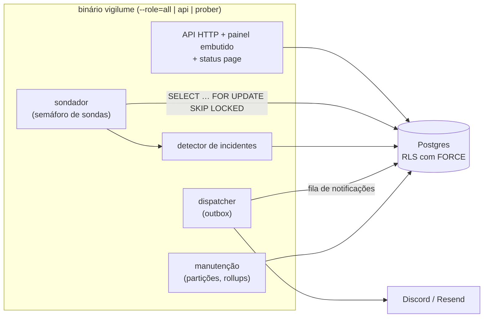

# Vigilume

Monitor de disponibilidade de serviços HTTP: sonda cada alvo no intervalo que você define, abre e
fecha incidentes sozinho, avisa pelo Discord e por e-mail, e publica uma página de status. Um
binário Go com o painel React embutido e um Postgres.

[](https://github.com/BipoXDXD/vigilume/actions/workflows/ci.yml)


## Rodar local

Precisa de Docker 25+ com Compose v2.20+ (o healthcheck usa `start_interval`).

```sh
git clone git@github.com:BipoXDXD/vigilume.git && cd vigilume
docker compose up --wait
```

Abra <http://localhost:8080> e entre com `demo@vigilume.local` / `demo-vigilume-2026`. O painel já
tem um alvo de exemplo, `https://example.com/` (domínio reservado para isso). Para cadastrar mais
no primeiro `up`: `DEMO_TARGETS_EXTRA="https://seu.site/ https://outro.site/" docker compose up --wait`.

- **Enquanto o repositório for privado**, a imagem publicada também é privada, e o compose
  **constrói do código** quando o pull é negado. Medido numa máquina de 16 núcleos: o build frio
  da imagem, num builder novo, levou ~34 s (provavelmente já contando o download das
  imagens-base); o `up --wait` levou ~4,5–5 s com as imagens prontas e ~8 s quando também
  construiu. Num notebook comum, o build demora mais. Depois
  que o job `publish` da `main` tiver rodado, quem tem acesso ao repositório pode puxar a imagem
  pronta (`docker login ghcr.io` com um token `read:packages`, depois `docker compose pull`).
- Use **`localhost`**, não o IP da máquina: o painel exige contexto seguro (HTTPS ou
  `localhost`). Em HTTP por outro endereço ele mostra um aviso e desliga a coordenação entre
  abas. A porta só escuta no `127.0.0.1`.
- Os alvos de exemplo precisam de internet. Um serviço rodando na sua máquina ou no próprio
  compose **não** pode ser alvo: o sondador recusa endereço privado, de propósito (SSRF, abaixo).
- As chaves do `compose.yaml` são de demonstração e estão no repositório. O boot valida a
  `PUBLIC_BASE_URL` (esquema `http` ou `https`, com host, sem usuário e senha) e só aceita essas
  chaves com `http` e host de loopback (`localhost` ou IP de loopback, como `127.0.0.1` e `::1`).
  Com `https` ele recusa sempre, até em `https://localhost`; com qualquer outro host, também: o
  compose copiado para um servidor não sobe com elas.

`docker compose down` para; `docker compose down -v` apaga o banco também.

## O que faz

- **Sonda** alvos HTTP (GET, HEAD ou POST) de 30 s a 24 h, com headers cifrados, status
  esperado e limite de latência para "degradado".
- **Incidentes** abrem depois de falhas seguidas e fecham depois de sucessos seguidos, com
  histórico por alvo.
- **Notificações** pelo Discord e por e-mail (Resend), com entrega confiável: saem de uma fila
  no próprio Postgres e sobrevivem a um restart.
- **Página de status pública** em `/p/{slug}`, com os alvos que você escolher, uptime de 90 dias
  e os incidentes recentes.
- **Painel** com dashboard, gráfico de latência, 2FA (TOTP), sessões e troca de senha.

## Arquitetura



Um processo só, que também roda partido (`--role=api` e `--role=prober`) sem mudar código: o
Postgres é a fila (`SKIP LOCKED`), então dois sondadores nunca pegam o mesmo alvo. Sem Redis nem
Kafka, porque o volume de um monitor destes cabe com folga no banco que já existe
([spec §17](docs/superpowers/specs/2026-09-22-vigilume-design.md)).

## Decisões de segurança

| Decisão | Código | Teste que prova |
|---|---|---|
| SSRF: o IP é validado **na hora de conectar** (`ControlContext`), não só no cadastro, o que fecha o DNS rebinding; redirect revalidado a cada salto | [`safedial`](internal/prober/safedial/safedial.go), [`transport.go`](internal/prober/safedial/transport.go) | [`transport_test.go`](internal/prober/safedial/transport_test.go) (`TestRedirectToAnotherInternalAddressIsBlockedAtTheHop`) |
| Isolamento por usuário com **RLS e `FORCE`**; o boot recusa um papel com superusuário ou `BYPASSRLS` | [`00004_targets_checks.sql`](internal/storage/migrations/00004_targets_checks.sql), [`role.go`](internal/storage/role.go) | [`rls_test.go`](internal/storage/rls_test.go) (`TestRLSIsolatesTargetsEvenWithTheWrongFilter`), [`role_test.go`](internal/storage/role_test.go) |
| Access token só em memória; refresh em cookie `HttpOnly`, `SameSite=Strict`, com rotação e detecção de reúso que derruba a família | [`authhandlers.go`](internal/httpapi/authhandlers.go), [`sessao.ts`](web/src/lib/api/sessao.ts) | [`auth_integration_test.go`](internal/httpapi/auth_integration_test.go) (`TestReusedRefreshCookieRevokesTheWholeFamily`) |
| Segredos com AES-256-GCM e o id da linha como AAD (um texto cifrado não muda de linha); tipo `Secret` que não sai em log nem em JSON | [`box.go`](internal/crypto/box.go), [`secret.go`](internal/crypto/secret.go) | [`box_test.go`](internal/crypto/box_test.go) (`TestOpenRejectsCiphertextMovedToAnotherRow`), [`secret_test.go`](internal/crypto/secret_test.go) |
| Chaves de demonstração do compose aceitas no boot só com `PUBLIC_BASE_URL` `http` em `localhost` ou IP de loopback; `https` recusado sempre, em qualquer host; URL malformada ou com usuário e senha recusada | [`config.go`](internal/config/config.go) | [`config_test.go`](internal/config/config_test.go) (`TestLoadRejectsDemoKeysOverHTTPS`, `TestLoadRejectsDemoKeysOnANonLoopbackHost`, `TestLoadAcceptsDemoKeysOnLoopback`, `TestLoadRejectsMalformedPublicBaseURL`), [`compose_test.go`](internal/config/compose_test.go) (`TestComposeUsesTheDemoKeys`) |
| Status page com DTO próprio: nada interno chega à página pública | [`public.go`](internal/statuspage/public.go) | [`public_test.go`](internal/statuspage/public_test.go) (`TestPublicViewHasNoInternalFields`) |
| IP real do cliente atrás do proxy, com falha **fechada**: o cabeçalho (`Fly-Client-IP` no Fly) só vale vindo de `TRUSTED_PROXIES`, e um prefixo `/0` ali é recusado no boot | [`clientip.go`](internal/httpapi/middleware/clientip.go) | [`clientip_test.go`](internal/httpapi/middleware/clientip_test.go) (`TestRateLimitSeparatesClientsBehindFly`), `TestSessionsBehindFlyRecordDistinctOrigins`, [`config_test.go`](internal/config/config_test.go) (`TestLoadRejectsAZeroBitTrustedProxy`) |
| CSP com nonce por resposta, no painel e na status page | [`webui.go`](internal/webui/webui.go), [`publicpage.go`](internal/httpapi/publicpage.go) | [`publicpage_integration_test.go`](internal/httpapi/publicpage_integration_test.go) (`TestPublicPageRendersWithoutLeaking`); E2E: [`fluxo.spec.ts`](web/e2e/fluxo.spec.ts) (zero violações, com controle positivo) |
| Imagem distroless **nonroot, sem shell**, Trivy sem achado HIGH/CRITICAL corrigível, varredura de segredos (gitleaks) no histórico inteiro em todo PR | [`Dockerfile`](Dockerfile), [`ci.yml`](.github/workflows/ci.yml), [`.gitleaks.toml`](.gitleaks.toml) | [`checar-imagem.sh`](deploy/ci/checar-imagem.sh) |

## Concorrência

- O sondador reivindica só o que cabe no [semáforo](internal/prober/scheduler.go) e devolve a
  vaga até em panic (`TestProbePanicIsLoggedAndReturnsTheSlot`).
- Cada subsistema roda num [`errgroup`](cmd/vigilume/main.go): se um cai, os outros encerram, e o
  processo sai com erro em vez de ficar meio vivo. Shutdown gracioso com prazo de 15 s, e sondas
  interrompidas não viram falso "fora do ar".
- No painel, o refresh do token é *single-flight* e coordenado entre abas por Web Locks
  ([`sessao.ts`](web/src/lib/api/sessao.ts)); duas abas recarregando juntas não derrubam a sessão
  ([`abas.spec.ts`](web/e2e/abas.spec.ts)).

## Testes

```sh
make test          # Go com -race; precisa de Docker (Postgres real via testcontainers)
make test-short    # sem Docker
cd web && npm test # Vitest do painel
make e2e           # APAGA o banco do compose, sobe com --build, confere e roda o Playwright
```

- **Sem mock de banco**: RLS, `SKIP LOCKED`, partições e advisory locks só se provam num
  Postgres de verdade. O CI roda a suíte no **17 e no 18**, cada um fixado por digest.
- O **E2E** (Playwright, Chromium) roda no CI contra o **mesmo `compose.yaml`** deste README, com a
  imagem que acabou de passar no Trivy: o "sobe com um comando" é teste de regressão. As specs
  rodam em série. O fluxo principal espera ~21 s antes de começar, para os limitadores de
  requisição (login e por usuário) encherem de novo depois das specs anteriores, e a limpeza do
  fim, que roda com os baldes gastos, repete com recuo (até ~30 s) quando leva um 429.
- O **backup** de produção tem workflow próprio que restaura o dump num banco descartável e o
  confere; ele roda todo dia depois de ligado (`BACKUP_ENABLED=1`), o que só acontece depois do
  primeiro deploy.
- **Prova por sabotagem.** Todo teste que afirma uma ausência ("o segredo não vaza", "o cliente
  não alcança") é conferido quebrando a propriedade de propósito e vendo ficar vermelho. Um caso
  real: os testes de middleware montavam a cadeia à mão, e apagar `SecurityHeaders`, `CORS` e
  `BodyLimit` de `routes.go` deixava a suíte verde; daí nasceu
  `TestTheMiddlewareChainIsActuallyWired`.

## Stack

| Camada | Escolha |
|---|---|
| Backend | Go 1.26, `net/http`, pgx, sqlc, goose, `log/slog`, Prometheus |
| Banco | PostgreSQL 18 (compatível com o 17) |
| Painel | React 19, TypeScript, Vite, TanStack Query, React Router, React Hook Form + Zod, Radix, Tailwind, Recharts |
| Testes | `testing` + testcontainers, Vitest + Testing Library + MSW, Playwright + axe |
| Entrega | Docker (distroless), GitHub Actions, GHCR, Fly.io |

## Desenvolvimento

```sh
make build            # bin/vigilume, com a versão do git describe
make generate         # sqlc generate, depois de mudar internal/storage/queries
make lint sec         # vet, staticcheck, gosec, govulncheck (instalados no PATH)
make image            # a imagem de produção
make up               # docker compose up --wait --build: o compose com o código que você tem
cd web && npm run dev # o painel em http://localhost:5173, com proxy de /api para :8080
```

Depois de mudar o código, `docker compose up --build` (ou `make up`): sem o `--build`, o compose
reusa a imagem que já tem. Para o `npm run dev`, suba a API pelo compose (o `CORS_ORIGIN` do
compose já é o do Vite). Criar ou recuperar o usuário dono: `vigilume user create --email <e>` e
`vigilume user set-password --email <e>`, com a senha pelo stdin.

## Deploy e operação

Dois apps no Fly.io: o binário (`--role=all`) e um Postgres 18 com a imagem oficial, sem gerência
do Fly, só na rede privada. **Nada disso foi criado ainda**: os artefatos e o runbook existem, e o
primeiro deploy é decisão do dono do projeto.

- **Imagem:** ~7,6 MB comprimida. A de produção sai do mesmo código e das mesmas bases fixadas
  por digest que o E2E testou, mas é construída de novo no `publish` (amd64 e arm64) e
  **reescaneada** pelo Trivy antes de ganhar as tags `:<sha do commit>` e `:latest`.
- **Deploy:** sempre manual (Actions → deploy → Run workflow), só da `main` e só de um commit
  que está nela, com o **SHA do commit** como entrada. O job resolve a tag `:<sha>`, que só
  existe depois do reescaneamento, no digest dela, copia a imagem por esse digest para o
  registry do Fly e faz o deploy. No GitHub Free com repositório privado não há revisor
  obrigatório: quem pode disparar é quem tem acesso de escrita ao repositório (hoje, só o dono),
  e os tokens do Fly são secrets de repositório.
- **Backup:** dump lógico diário, cifrado com `age`, restaurado num banco descartável e
  conferido (dono das tabelas, RLS com `FORCE`, contagens, partições). Uma checagem que falha
  sai com código 3. Disco acima de 85% sai com código 4: o dump já conferido é cifrado e guardado
  mesmo assim, e o job fica vermelho no fim.

Runbook: [`docs/deploy/fly.md`](docs/deploy/fly.md).

## O que ficou de fora, e por quê

- **Vários usuários, times e planos**: dobraria o prazo sem somar sinal técnico novo. É um
  sistema de um dono; a RLS isola por usuário mesmo assim.
- **Sondas TCP, ICMP e DNS, e de várias regiões**: HTTP já exercita o pipeline inteiro; várias
  regiões exigem infraestrutura distribuída.
- **Slack, Telegram, webhook genérico**: dois canais já provam a abstração de notificação.
- **SSE ou WebSocket no painel**: o painel consulta de tempos em tempos, e isso basta.
- **Domínio próprio na status page**: verificação de DNS é escopo próprio.
- **Réplica, failover e PITR do Postgres**: um nó com snapshot diário e dump diário basta para
  este volume; no pior caso, perde-se um dia de checks.
- **Métricas raspadas em produção**: exigiriam abrir o endpoint na rede privada do Fly.

Os motivos completos estão na [spec](docs/superpowers/specs/2026-09-22-vigilume-design.md) (§2.2)
e nos [planos](docs/superpowers/plans/).

## Licença

Ainda não definida (repositório privado). A escolha é do dono do projeto e vem junto com a
publicação ([runbook](docs/deploy/fly.md), "Tornar o repositório público").
