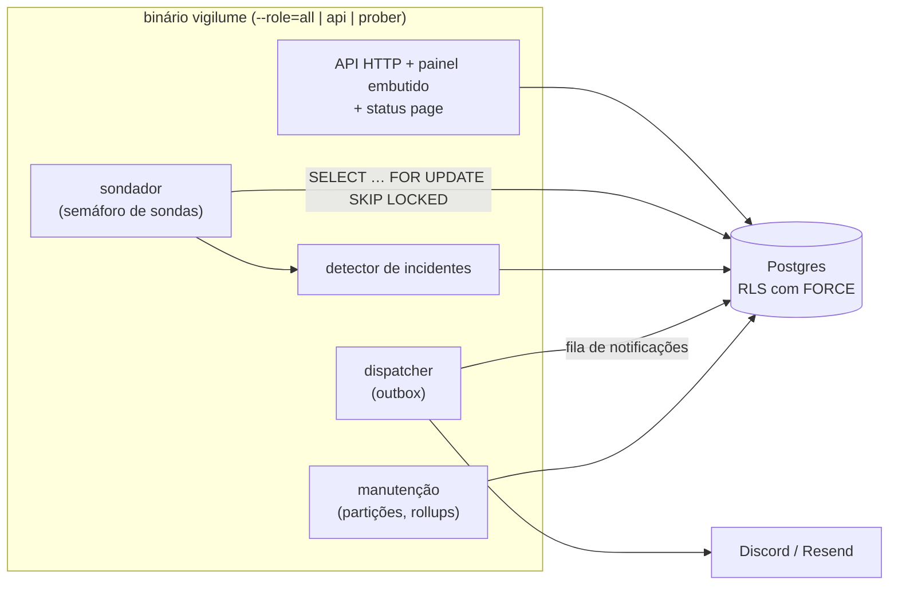

# Vigilume

Monitor de disponibilidade de serviços HTTP: sonda cada alvo no intervalo que você define, abre e
fecha incidentes sozinho, avisa pelo Discord e por e-mail, e publica uma página de status. Um
binário Go com o painel React embutido e um Postgres.

[](https://github.com/BipoXDXD/vigilume/actions/workflows/ci.yml)


## Rodar local

Precisa de Docker 25+ com Compose v2.20+ (o healthcheck usa `start_interval`).

```sh
git clone git@github.com:BipoXDXD/vigilume.git && cd vigilume
docker compose up --wait
```

Abra <http://localhost:8080> e entre com `demo@vigilume.local` / `demo-vigilume-2026`. O painel já
tem um alvo de exemplo, `https://example.com/` (domínio reservado para isso). Para cadastrar mais
no primeiro `up`: `DEMO_TARGETS_EXTRA="https://seu.site/ https://outro.site/" docker compose up --wait`.

- **Enquanto o repositório for privado**, a imagem publicada também é privada, e o compose
  **constrói do código** quando o pull é negado. Medido numa máquina de 16 núcleos: o build frio
  da imagem, num builder novo, levou ~34 s (provavelmente já contando o download das
  imagens-base); o `up --wait` levou ~4,5–5 s com as imagens prontas e ~8 s quando também
  construiu. Num notebook comum, o build demora mais. Depois
  que o job `publish` da `main` tiver rodado, quem tem acesso ao repositório pode puxar a imagem
  pronta (`docker login ghcr.io` com um token `read:packages`, depois `docker compose pull`).
- Use **`localhost`**, não o IP da máquina: o painel exige contexto seguro (HTTPS ou
  `localhost`). Em HTTP por outro endereço ele mostra um aviso e desliga a coordenação entre
  abas. A porta só escuta no `127.0.0.1`.
- Os alvos de exemplo precisam de internet. Um serviço rodando na sua máquina ou no próprio
  compose **não** pode ser alvo: o sondador recusa endereço privado, de propósito (SSRF, abaixo).
- As chaves do `compose.yaml` são de demonstração e estão no repositório. O boot valida a
  `PUBLIC_BASE_URL` (esquema `http` ou `https`, com host, sem usuário e senha) e só aceita essas
  chaves com `http` e host de loopback (`localhost` ou IP de loopback, como `127.0.0.1` e `::1`).
  Com `https` ele recusa sempre, até em `https://localhost`; com qualquer outro host, também. O
  boot só olha a URL **declarada**: o compose copiado para um servidor com um proxy na frente e a
  `PUBLIC_BASE_URL` ainda `http://localhost:8080` sobe com elas (ver abaixo).
- **O `compose.yaml` é só para a máquina local, nunca para servidor.** O usuário de
  demonstração tem senha pública, e o sistema é de um dono só: num servidor, ele seria o dono. O
  `seed` recusa rodar (sai com 1, e o `up` para) se a `PUBLIC_BASE_URL` não for `http` em
  `localhost` ou IP de loopback. **Isso não protege um servidor**: atrás de um proxy (um Caddy com
  `reverse_proxy app:8080`) e com a `PUBLIC_BASE_URL` ainda local, o seed e o boot aceitam, o
  usuário de demonstração nasce, e qualquer um entra com a senha pública. O app não confere o
  `Host` recebido. Para hospedar, use o compose de produção de [`deploy/vps/`](deploy/vps/), sem
  o `seed` e sem nenhuma chave ou senha do repositório, pelo [runbook](docs/deploy/vps.md).

`docker compose down` para; `docker compose down -v` apaga o banco também.

## O que faz

- **Sonda** alvos HTTP (GET, HEAD ou POST) de 30 s a 24 h, com headers cifrados, status
  esperado e limite de latência para "degradado".
- **Incidentes** abrem depois de falhas seguidas e fecham depois de sucessos seguidos, com
  histórico por alvo.
- **Notificações** pelo Discord e por e-mail (Resend), com entrega confiável: saem de uma fila
  no próprio Postgres e sobrevivem a um restart.
- **Página de status pública** em `/p/{slug}`, com os alvos que você escolher, uptime de 90 dias
  e os incidentes recentes.
- **Painel** com dashboard, gráfico de latência, 2FA (TOTP), sessões e troca de senha.

## Arquitetura



Um processo só, que também roda partido (`--role=api` e `--role=prober`) sem mudar código: o
Postgres é a fila (`SKIP LOCKED`), então dois sondadores nunca pegam o mesmo alvo. Sem Redis nem
Kafka, porque o volume de um monitor destes cabe com folga no banco que já existe
([spec §17](docs/superpowers/specs/2026-09-22-vigilume-design.md)).

## Decisões de segurança

| Decisão | Código | Teste que prova |
|---|---|---|
| SSRF: o IP é validado **na hora de conectar** (`ControlContext`), não só no cadastro, o que fecha o DNS rebinding; redirect revalidado a cada salto | [`safedial`](internal/prober/safedial/safedial.go), [`transport.go`](internal/prober/safedial/transport.go) | [`transport_test.go`](internal/prober/safedial/transport_test.go) (`TestRedirectToAnotherInternalAddressIsBlockedAtTheHop`) |
| Isolamento por usuário com **RLS e `FORCE`**; o boot recusa um papel com superusuário ou `BYPASSRLS` | [`00004_targets_checks.sql`](internal/storage/migrations/00004_targets_checks.sql), [`role.go`](internal/storage/role.go) | [`rls_test.go`](internal/storage/rls_test.go) (`TestRLSIsolatesTargetsEvenWithTheWrongFilter`), [`role_test.go`](internal/storage/role_test.go) |
| Access token só em memória; refresh em cookie `HttpOnly`, `SameSite=Strict`, com rotação e detecção de reúso que derruba a família | [`authhandlers.go`](internal/httpapi/authhandlers.go), [`sessao.ts`](web/src/lib/api/sessao.ts) | [`auth_integration_test.go`](internal/httpapi/auth_integration_test.go) (`TestReusedRefreshCookieRevokesTheWholeFamily`) |
| Segredos com AES-256-GCM e o id da linha como AAD (um texto cifrado não muda de linha); tipo `Secret` que não sai em log nem em JSON | [`box.go`](internal/crypto/box.go), [`secret.go`](internal/crypto/secret.go) | [`box_test.go`](internal/crypto/box_test.go) (`TestOpenRejectsCiphertextMovedToAnotherRow`), [`secret_test.go`](internal/crypto/secret_test.go) |
| Chaves de demonstração do compose aceitas no boot só com `PUBLIC_BASE_URL` `http` em `localhost` ou IP de loopback; `https` recusado sempre, em qualquer host; URL malformada ou com usuário e senha recusada | [`config.go`](internal/config/config.go) | [`config_test.go`](internal/config/config_test.go) (`TestLoadRejectsDemoKeysOverHTTPS`, `TestLoadRejectsDemoKeysOnANonLoopbackHost`, `TestLoadAcceptsDemoKeysOnLoopback`, `TestLoadRejectsMalformedPublicBaseURL`), [`compose_test.go`](internal/config/compose_test.go) (`TestComposeUsesTheDemoKeys`) |
| Status page com DTO próprio: nada interno chega à página pública | [`public.go`](internal/statuspage/public.go) | [`public_test.go`](internal/statuspage/public_test.go) (`TestPublicViewHasNoInternalFields`) |
| IP real do cliente atrás do proxy, com falha **fechada**: o `X-Forwarded-For` (ou o cabeçalho de `CLIENT_IP_HEADER`) só vale vindo de `TRUSTED_PROXIES`, e um prefixo `/0` ali é recusado no boot. `CLIENT_IP_HEADER` só serve atrás de proxy que **substitui** esse cabeçalho; atrás do Caddy da produção ele fica **vazio**, o `TRUSTED_PROXIES` é o IP fixo do Caddy na rede do compose, e vale o último salto do `X-Forwarded-For`, com todas as linhas lidas juntas. O Caddy remove `X-Real-IP`, `Fly-Client-IP` e `CF-Connecting-IP` vindos do cliente. Com `PUBLIC_BASE_URL` https, um `X-Forwarded-For` de fora de `TRUSTED_PROXIES` vira aviso no log (um por minuto, com o `remote_addr`) | [`clientip.go`](internal/httpapi/middleware/clientip.go) | [`clientip_test.go`](internal/httpapi/middleware/clientip_test.go) (`TestRateLimitSeparatesClientsBehindFly`, `TestClientIPJoinsEveryForwardedForLine`), `TestSessionsBehindFlyRecordDistinctOrigins`, `TestForwardedForFromOutsideTheListWarnsInProduction`, [`config_test.go`](internal/config/config_test.go) (`TestLoadRejectsAZeroBitTrustedProxy`) |
| Argon2id com teto de concorrência: toda verificação e todo hash (inclusive o do e-mail inexistente) passam por um semáforo de `min(NumCPU, 4)` vagas (`ARGON2_MAX_CONCURRENT`, 1–64); sem vaga em 2 s, `429 rate_limited` com `Retry-After: 2`, em vez de o processo morrer sem memória | [`argon2.go`](internal/auth/argon2.go) | [`argon2_test.go`](internal/auth/argon2_test.go) (`TestEveryArgon2PathWaitsForASlot`), [`argon2_integration_test.go`](internal/httpapi/argon2_integration_test.go) (`TestSaturatedArgon2AnswersRateLimited`) |
| Bloqueio de conta atômico (a tentativa é reservada **antes** do Argon2 ou do TOTP: N requisições paralelas gastam N tentativas) e sem negação de serviço ao dono: um login completo deixa o cookie de dispositivo `vigilume_dispositivo`, e quem o apresenta não é barrado pelo bloqueio que um anônimo provocou; nas rotas autenticadas, a 5ª prova errada revoga a família da sessão | [`user.go`](internal/auth/user.go), [`dispositivo.go`](internal/auth/dispositivo.go), [`provas.go`](internal/auth/provas.go), [`provas.go` (httpapi)](internal/httpapi/provas.go) | [`user_test.go`](internal/auth/user_test.go) (`TestConcurrentReservationsStopAtTheThreshold`), [`dispositivo_integration_test.go`](internal/httpapi/dispositivo_integration_test.go) (`TestParallelLoginGuessesStopAtTheLock`, `TestDeviceCookieLetsTheOwnerInPastTheAccountLock`), [`dispositivo_revogacao_integration_test.go`](internal/httpapi/dispositivo_revogacao_integration_test.go) (`TestDeviceCookieDiesWithTheCredentials`), [`provas_familia_integration_test.go`](internal/httpapi/provas_familia_integration_test.go) (`TestFifthWrongProofDropsTheFamily`) |
| O `seed` do compose recusa `PUBLIC_BASE_URL` fora de `http` em loopback, antes de chamar o binário. Isso **não** protege um servidor: atrás de um proxy e com a URL ainda local, ele roda e o usuário de demonstração nasce. O `compose.yaml` é só para a máquina local; para hospedar, o compose de produção de `deploy/vps/`, sem o `seed` | [`seed.sh`](deploy/compose/seed.sh) | [`seed_test.go`](internal/config/seed_test.go) (`TestSeedRefusesOutsideLoopback`), [`compose_test.go`](internal/config/compose_test.go) (`TestComposeHeaderSaysItIsLocalOnly`) |
| Produção: só o Caddy publica porta (80 e 443); uma requisição com outro `Host` não chega ao app; `X-Real-IP`, `Fly-Client-IP` e `CF-Connecting-IP` mandados pelo cliente são removidos; o banco não aceita conexão de fora da rede do compose; rede sem IPv6 | [`compose.prod.yaml`](deploy/vps/compose.prod.yaml), [`Caddyfile`](deploy/vps/Caddyfile) | [`checar-vps.sh`](deploy/ci/checar-vps.sh) (job `vps` do CI: sobe o compose de produção com o Caddy em modo local; blocos 1 a 7) |
| Deploy por uma chave SSH que só roda um script: verbo desconhecido, SHA malformado, imagem divergente e o SHA no ar (ou o anterior) já etiquetado com outra imagem recusados; rollback automático se a versão nova não ficar saudável; o backup só devolve texto cifrado | [`vigilume-entrada`](deploy/vps/vigilume-entrada) | [`checar-vps.sh`](deploy/ci/checar-vps.sh), blocos 2, 8 (recusas, imagem divergente, rollback, store, `sudoers`) e 9 (backup) |
| CSP com nonce por resposta, no painel e na status page | [`webui.go`](internal/webui/webui.go), [`publicpage.go`](internal/httpapi/publicpage.go) | [`publicpage_integration_test.go`](internal/httpapi/publicpage_integration_test.go) (`TestPublicPageRendersWithoutLeaking`); E2E: [`fluxo.spec.ts`](web/e2e/fluxo.spec.ts) (zero violações, com controle positivo) |
| Imagem distroless **nonroot, sem shell**, Trivy sem achado HIGH/CRITICAL corrigível, varredura de segredos (gitleaks) no histórico inteiro em todo PR | [`Dockerfile`](Dockerfile), [`ci.yml`](.github/workflows/ci.yml), [`.gitleaks.toml`](.gitleaks.toml) | [`checar-imagem.sh`](deploy/ci/checar-imagem.sh) |
| Versão nova de dependência Go ou npm espera 7 dias antes de entrar no PR do Dependabot (as atualizações de segurança não esperam); a chave privada do `age` e os dumps do backup não entram no git | [`dependabot.yml`](.github/dependabot.yml), [`.gitignore`](.gitignore) | [`repositorio_test.go`](internal/config/repositorio_test.go) (`TestDependabotWaitsSevenDaysForGoAndNpm`, `TestGitignoreCoversTheBackupKeyAndDumps`) |

## Concorrência

- O sondador reivindica só o que cabe no [semáforo](internal/prober/scheduler.go) e devolve a
  vaga até em panic (`TestProbePanicIsLoggedAndReturnsTheSlot`).
- Cada subsistema roda num [`errgroup`](cmd/vigilume/main.go): se um cai, os outros encerram, e o
  processo sai com erro em vez de ficar meio vivo. Shutdown gracioso com prazo de 15 s, e sondas
  interrompidas não viram falso "fora do ar".
- No painel, o refresh do token é *single-flight* e coordenado entre abas por Web Locks
  ([`sessao.ts`](web/src/lib/api/sessao.ts)); duas abas recarregando juntas não derrubam a sessão
  ([`abas.spec.ts`](web/e2e/abas.spec.ts)).

## Testes

```sh
make test          # Go com -race; precisa de Docker (Postgres real via testcontainers)
make test-short    # sem Docker
cd web && npm test # Vitest do painel
make e2e           # APAGA o banco do compose, sobe com --build, confere e roda o Playwright
```

- **Sem mock de banco**: RLS, `SKIP LOCKED`, partições e advisory locks só se provam num
  Postgres de verdade. O CI roda a suíte no **17 e no 18**, cada um fixado por digest.
- O **E2E** (Playwright, Chromium) roda no CI contra o **mesmo `compose.yaml`** deste README, com a
  imagem que acabou de passar no Trivy: o "sobe com um comando" é teste de regressão. As specs
  rodam em série. O fluxo principal espera ~21 s antes de começar, para os limitadores de
  requisição (login e por usuário) encherem de novo depois das specs anteriores, e a limpeza do
  fim, que roda com os baldes gastos, repete com recuo (até ~30 s) quando leva um 429.
- O **backup** de produção tem workflow próprio que restaura o dump num banco descartável e o
  confere; ele roda todo dia depois de ligado (`BACKUP_ENABLED=1`), o que só acontece depois do
  primeiro deploy.
- **Prova por sabotagem.** Todo teste que afirma uma ausência ("o segredo não vaza", "o cliente
  não alcança") é conferido quebrando a propriedade de propósito e vendo ficar vermelho. Um caso
  real: os testes de middleware montavam a cadeia à mão, e apagar `SecurityHeaders`, `CORS` e
  `BodyLimit` de `routes.go` deixava a suíte verde; daí nasceu
  `TestTheMiddlewareChainIsActuallyWired`.

## Stack

| Camada | Escolha |
|---|---|
| Backend | Go 1.26, `net/http`, pgx, sqlc, goose, `log/slog`, Prometheus |
| Banco | PostgreSQL 18 (compatível com o 17) |
| Painel | React 19, TypeScript, Vite, TanStack Query, React Router, React Hook Form + Zod, Radix, Tailwind, Recharts |
| Testes | `testing` + testcontainers, Vitest + Testing Library + MSW, Playwright + axe |
| Entrega | Docker (distroless), GitHub Actions, GHCR, uma VPS (Hostinger) com Caddy |

## Desenvolvimento

```sh
make build            # bin/vigilume, com a versão do git describe
make generate         # sqlc generate, depois de mudar internal/storage/queries
make lint sec         # vet, staticcheck, gosec, govulncheck (instalados no PATH)
make image            # a imagem de produção
make up               # docker compose up --wait --build: o compose com o código que você tem
cd web && npm run dev # o painel em http://localhost:5173, com proxy de /api para :8080
```

Depois de mudar o código, `docker compose up --build` (ou `make up`): sem o `--build`, o compose
reusa a imagem que já tem. Para o `npm run dev`, suba a API pelo compose (o `CORS_ORIGIN` do
compose já é o do Vite). Criar ou recuperar o usuário dono: `vigilume user create --email <e>` e
`vigilume user set-password --email <e>`, com a senha pelo stdin. Quem perdeu o autenticador **e**
os códigos de recuperação: `vigilume user reset-2fa --email <e>` desliga o 2FA, zera o bloqueio da
conta e encerra todas as sessões (não pede senha: só lê a `DATABASE_URL`); depois, entre com a senha e ative de novo pelo
painel. Sem 2FA ligado, o comando diz "nada mudou" e não mexe em nada, **nem no bloqueio**: para
destravar uma conta sem 2FA, use o `set-password`.

Para rodar a API e o sondador separados no mesmo host (`--role=api` e `--role=prober`), não
precisa configurar nada: sem `METRICS_ADDR`, a porta de métricas é `127.0.0.1:9090` para `api` e
`all` e `127.0.0.1:9091` para `prober`.

## API

REST sob `/api/v1`, usada pelo painel (a [spec, §9](docs/superpowers/specs/2026-09-22-vigilume-design.md)
tem as convenções). Todo erro, inclusive rota ou método inexistente sob `/api/`, vem no envelope
`{"error": {"code", "message"}, "trace_id"}`; o `code` é o contrato, a `message` é para gente.

- `401 unauthorized` é só token recusado (ausente, inválido, vencido, de família morta): o
  cliente renova a sessão. `401 invalid_credentials` é senha ou código errado: não renova.
- `429 rate_limited` vem dos limitadores por IP e por usuário (sem `Retry-After`) e, desde o
  Plano 10, do teto de concorrência do Argon2id (com `Retry-After: 2`).
- Mutação exige o cabeçalho `X-Requested-With: vigilume`.

O que mudou no Plano 10 (spec do Plano 10, §4):

| Rota | Antes | Agora |
|---|---|---|
| `POST /auth/login`, `/auth/password`, `/auth/totp/enroll`, `/auth/totp/disable`, `/auth/totp/rotate` (as que pagam Argon2id) | — | `429 rate_limited` com `Retry-After: 2` quando o Argon2id não tem vaga em 2 s |
| Rotas autenticadas de credencial (`/auth/password`, `/auth/totp/enroll`, `confirm`, `disable`, `rotate`, `rotate/confirm`) | conta bloqueada → `401 invalid_credentials` | não olham o bloqueio da conta; a 5ª prova errada na mesma família de sessão (as seis rotas dividem o contador) revoga a família e responde `401 unauthorized`; da 1ª à 4ª, a resposta de sempre (`401 invalid_credentials`; `400 validation_failed` no `confirm`, que antes não contava falha); com o 2FA ligado, o `confirm` e o `enroll` respondem `403 forbidden` sem conferir o código e sem zerar o contador (só a prova do fator o zera) |
| `POST /auth/totp/rotate` | `{"otpauth_uri"}` | mais `"rotation"` (32 caracteres hexadecimais) |
| `POST /auth/totp/rotate/confirm` | `{"code"}` | `{"code", "rotation"}`; `rotation` ausente ou diferente do da troca em andamento → `403 forbidden`, antes do código e sem contar falha |
| `POST /auth/logout` | `204` mesmo com a revogação falhando | `500 internal` sem apagar o cookie, para tentar de novo |
| Rotas do TOTP com o usuário apagado no meio | `500 internal` | `401 unauthorized` |
| `PATCH /targets/{id}` que muda esquema, host ou porta da URL sem mandar `headers` | mantinha os headers | apaga os headers (`"header_names": []`); mudar só o caminho mantém |
| `POST` e `PATCH /targets` com `expected_status` 1xx ou 3xx | aceito (o alvo ficava `down` para sempre) | `400 validation_failed`, `out_of_range` |
| 404 e 405 sob `/api/` | texto puro do `net/http` | envelope: `404 not_found` e `405 method_not_allowed` (código novo) |
| `GET /targets/{id}/checks` | o painel mandava `from` calculado com o relógio do navegador | `?window=1h\|6h\|24h\|7d\|30d\|90d`: o servidor calcula `from = to − janela` com o relógio dele; `window` vazio, fora da lista ou junto com `from` → `400 validation_failed` (`window`/`invalid`); `from`/`to` sem `window` continuam valendo |
| Login completo (senha e, se ligado, 2FA) | — | cookie `vigilume_dispositivo` (`HttpOnly`, `SameSite=Strict`, `Path=/api/v1/auth`, 180 dias; `Secure` com `PUBLIC_BASE_URL` https), que dispensa o bloqueio da conta no login e no `/totp/verify`; morre com a troca de senha, o `set-password`, o `reset-2fa` e a ativação ou o disable do 2FA (o MAC cobre o hash da senha e a data de ativação do 2FA) |

## Deploy e operação

Uma VPS na Hostinger (Ubuntu 24.04), com três contêineres num compose de produção
([`deploy/vps/compose.prod.yaml`](deploy/vps/compose.prod.yaml)): o **Caddy**, com HTTPS
automático e o único que publica porta (80 e 443); o **binário** (`--role=all`), sem porta
publicada; e o **Postgres 18** com a imagem oficial fixada por digest, só na rede interna. Os
segredos ficam num `.env` do root na própria VPS, gerados lá, com cópia no gerenciador de senhas do
dono. A VPS vem endurecida pelo runbook: SSH só por chave e sem root, `fail2ban`, firewall no
sistema e no painel da Hostinger, atualizações de segurança automáticas.

- **Imagem:** ~7,6 MB comprimida. A de produção sai do mesmo código e das mesmas bases fixadas
  por digest que o E2E testou, mas é construída de novo no `publish` (amd64 e arm64) e
  **reescaneada** pelo Trivy antes de ganhar as tags `:<sha do commit>` e `:latest`.
- **Deploy:** sempre manual (Actions → deploy → Run workflow), só da `main` e só de um commit
  que está nela, com o **SHA do commit** como entrada. O job resolve a tag `:<sha>` (que só existe
  depois do reescaneamento) no digest, baixa a imagem linux/amd64 por esse digest e a entrega por
  SSH a um usuário `deploy` cuja chave só roda
  [`vigilume-entrada`](deploy/vps/vigilume-entrada): ele confere o ID da imagem, troca a versão,
  espera o healthcheck e **volta sozinho à anterior** se a nova não ficar saudável; se a conexão
  cair no meio, o deploy (ou o rollback) termina na própria VPS, que guarda o log de cada deploy e
  backup em `/opt/vigilume/entrada.log`. A chave do
  servidor é fixada num secret (nada de `StrictHostKeyChecking=no`). No GitHub Free com
  repositório privado não há revisor obrigatório: quem pode disparar é quem tem acesso de escrita
  ao repositório (hoje, só o dono).
- **Backup:** dump lógico diário, feito na VPS e restaurado num banco descartável e conferido
  (dono das tabelas, RLS com `FORCE`, contagens, partições) antes de sair **já cifrado** com
  `age` (a chave privada fica só com o dono) para um artifact de 30 dias. Uma checagem que falha
  sai com código 3; disco acima de 85% sai com 4 (o dump é guardado mesmo assim, e o job fica
  vermelho). Por cima, o backup semanal da Hostinger.
- **Vigia externo:** um timer na VPS consulta o `/healthz` público a cada minuto e pinga o
  healthchecks.io, que avisa o dono por e-mail se o site cair ou a VPS sumir: o Vigilume não
  consegue avisar da própria queda.

Runbook, do "VPS recém-criada" ao "no ar com 2FA, e-mail, backup e vigia", e a operação:
[`docs/deploy/vps.md`](docs/deploy/vps.md).

## O que ficou de fora, e por quê

- **Vários usuários, times e planos**: dobraria o prazo sem somar sinal técnico novo. É um
  sistema de um dono; a RLS isola por usuário mesmo assim.
- **Sondas TCP, ICMP e DNS, e de várias regiões**: HTTP já exercita o pipeline inteiro; várias
  regiões exigem infraestrutura distribuída.
- **Slack, Telegram, webhook genérico**: dois canais já provam a abstração de notificação.
- **SSE ou WebSocket no painel**: o painel consulta de tempos em tempos, e isso basta.
- **Domínio próprio na status page**: verificação de DNS é escopo próprio.
- **Réplica, failover e PITR do Postgres**: um nó com o dump diário conferido e cifrado, mais o
  backup semanal da VPS inteira na Hostinger, basta para este volume; no pior caso, perde-se um
  dia de checks.
- **Métricas raspadas em produção**: exigiriam um coletor na VPS; em produção,
  `METRICS_ADDR=off`.
- **Cotas por usuário no sondador e no despacho**: só o operador cria contas (pelo CLI), então
  quem as esgotaria é uma conta que o próprio dono criou. Volta à mesa se o cadastro abrir.

Os motivos completos estão na [spec](docs/superpowers/specs/2026-09-22-vigilume-design.md) (§2.2)
e nos [planos](docs/superpowers/plans/).

## Licença

Ainda não definida (repositório privado). A escolha é do dono do projeto e vem junto com a
publicação ([runbook](docs/deploy/vps.md), "Tornar o repositório público").
