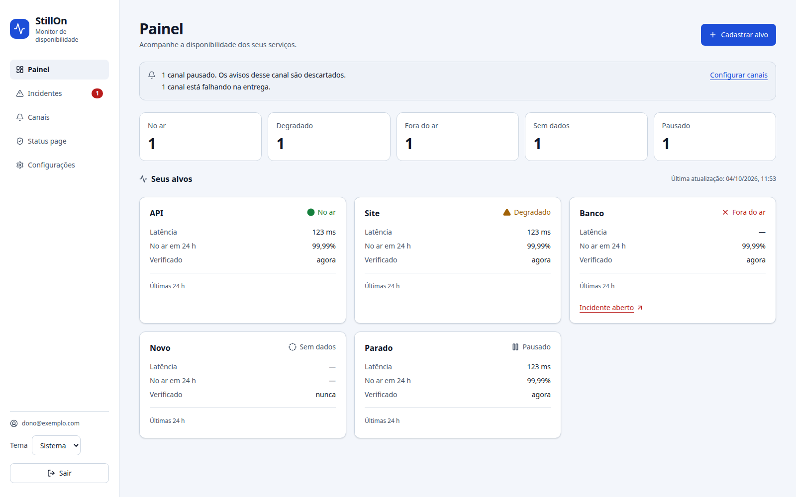
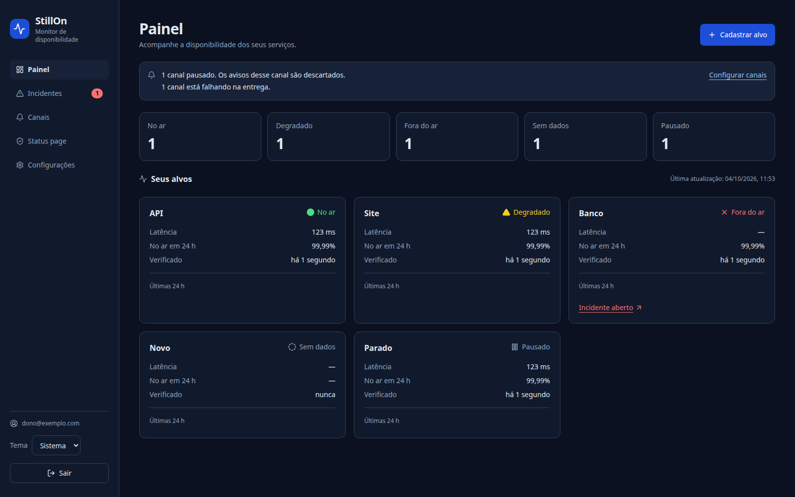
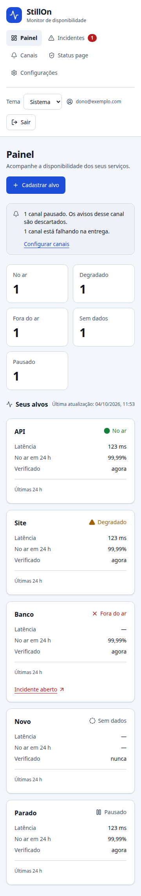
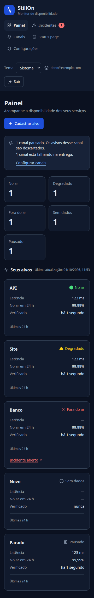

# Primeira onda do Plano 12 — 2026-10-04

Branch: `melhoria/plano-12-seguranca-painel`. Base: `cd81622`. Trabalho local autorizado pelo
 dono durante sua ausência; agentes GPT-6.1 High. O `AGENTS.md` inicial era não versionado
 e foi preservado. Nenhum acesso à VPS, alteração de DNS/segredos, push, merge, publicação
 de imagem ou execução remota de Actions foi feito nesta onda.

**Estado deste registro: código congelado, revisões aprovadas e gates locais finais verdes.**
Backend, painel, operação, SSH, as duas migrations e deadline HTTP receberam revisão
independente. O Plano 12 inteiro continua parcial; a integração por PR e a validação na
VPS real permanecem pendentes.

## Mudanças

| Área | Resultado |
| --- | --- |
| Sondador | Todos os headers personalizados caem em salto inseguro, inclusive User-Agent; a identificação pública volta. Cadeia que retorna à origem não recupera segredos. Host canonicalizado pelo mesmo helper IDNA usado no PATCH. |
| Conta | Hash da senha nova antes do consumo do segundo fator; `429` desse hash não gasta recovery/TOTP. CAS, família viva, trava e revogação preservados. |
| Provas de família | Fail conta erros efetivamente concluídos; reservas de geração antiga não devolvem vagas nem zeram a geração nova. Política de excesso em voo preservada. |
| Banco | Migration 00010 recusa check infinito ou mais de um minuto no futuro por INSERT/UPDATE, usando relógio do banco, inclusive partições futuras; transação não avança histerese na recusa. |
| TOTP | Migration 00011 exige presença conjunta de segredo/família pendentes. Valida legado; recusa inconsistência sem apagar ou reparar credenciais. |
| HTTP | Prazo cooperativo de 15 s para API/verificação, menor que WriteTimeout de 30 s. Cancela SQL e aquisição do pool; erro interno por prazo vencido usa 503 com envelope/trace existentes. Projeção pública preserva worker compartilhado de até 5 s. |
| Operação | Senhas PG fora de argv no initdb e backup; quoting psql preservado; credenciais na query do URI recusadas. Seed valida URL completa antes de criar demo. |
| Build | `npm ci --ignore-scripts` no Dockerfile e CI, mantendo opcionais; instalação e build reais Linux/Alpine conferidos. |
| SSH | OpenSSH e sudo reais em contêineres internos, chaves efêmeras, comando forçado e cliente vps.sh real; códigos/bytes/host key/PTY/comando arbitrário comprovados. Entrada remota simulada. |
| Painel | Lateral desktop, navegação móvel, tokens claro/escuro, contagens reais e cartões de latência/uptime; avisos de canais sem inventar ausência em erro. Guarda de Pausar durante Retomar; aviso HTTPS fora da lateral. |

Mantidos binário Go único, PostgreSQL, React embutido, DTOs, rotas e política de autenticação.
Nenhuma dependência Go/npm adicionada; os pacotes de sistema novos ficam na fixture SSH.
SQL à mão de auth/TOTP continua destinado ao Plano 13.

## Painel

Proposta implementada, conferida visualmente e por testes locais; aceitação estética pendente
 do dono. Capturas com fixtures, não produção. A revisão verificou foco, CSP, erros de polling
 e estados em voo; reproduziu e corrigiu a advertência de HTTPS inicialmente coberta pela lateral.

| Desktop claro | Desktop escuro |
| --- | --- |
|  |  |

| Celular claro, 360 px | Celular escuro, 360 px |
| --- | --- |
|  |  |

## Provas por sabotagem e revisão

Testes comportamentais novos foram observados vermelhos antes da correção, ou tiveram
 a propriedade sabotada de modo compilável quando testavam contrato existente. Sabotagens
 isoladas/restauradas cobriram headers, IDNA, saturação Argon2/recovery, Fail/geração, argv,
 SQL quoting, seed, contagens/avisos/mutação do painel, viewport, offset HTTPS e ambos os
 canais binários do SSH, propagação do prazo parental, wiring e classificação dos deadlines.
 As migrations foram sabotadas em cópias sob `/tmp`, preservando
 o checkout compartilhado. Não foi usada falha de build/infra como evidência de propriedade.

Revisões independentes aprovaram backend, operação, painel (após fechar P2), SSH, CHECK
 TOTP e deadline HTTP. Revisores examinaram código e logs; não afirmaram rerodar suítes que apenas leram.
 O próprio implementador não recebeu rótulo de revisor independente de seus fixes.

## Verificação integrada

Rodada final, depois de congelar também a correção de deadline, observada com código 0:

```sh
go build ./... && go vet ./... && make test
```

Resultado: exit 0, todos os pacotes com `-race`; PostgreSQL 18 real, HTTP API 161,219 s
e storage 23,688 s. A suíte completa também passou com PostgreSQL 17 real: HTTP API
161,296 s e storage 25,326 s. As durações incluem carga local simultânea, não são benchmarks.
Ambas as migrations passaram, incluindo INSERT/UPDATE, partição futura, rollback da
histerese e preservação do par TOTP; sabotagem e restauração confirmadas.

| Conferência | Resultado já observado |
| --- | --- |
| Painel typecheck/lint/Vitest/build | Verdes; 251 testes unitários |
| Playwright em pilha API/PostgreSQL real | 14/14, 4,2 min; fluxo, abas e troca usam backend real; acessibilidade/viewport/HTTPS usam fixtures de API sob CSP real |
| API, acessibilidade, CSP, teclado, temas e 360 px | Verdes na rodada integrada e na regressão HTTPS |
| `make lint sec` | Vet/staticcheck/gosec verdes; govulncheck sem vulnerabilidade alcançável/importada |
| npm audit completo e produção | 0 vulnerabilidades reportadas |
| Imagens runtime/tools | Construídas; Trivy sem HIGH/CRITICAL corrigível nas duas |
| Runtime nonroot, sem shell, versão e assets embutidos | Verde; imagem comprimida 7.679.693 bytes, abaixo do teto de 15 MB |
| Compose isolado, imagens desta branch | Login, papéis, seed, idempotência e persistência verdes; volume próprio removido |
| Backup/restauro PG18 com senha especial percent-encoded | Código 0; dump, schema, contagens, RLS e dono conferidos |
| SSH real | GREEN 8,48 s com cache; RED env_keep e byte extra restaurados. Build sem cache local 12,41 s (base já disponível, não mede runner frio inteiro). |
| ShellCheck, actionlint, workflows e 56 casos VPS | Verdes nos pacotes alterados |
| Ensaio completo local da VPS (`checar-vps.sh`) | Verde: Caddy, rede, deploy/rollback, códigos, backup cifrado/restauro e limpeza de volumes próprios; nenhum acesso à VPS real |
| `sqlc generate` | Verde; nenhum diff no código gerado |
| Gitleaks histórico e diff staged | Sem achados; histórico 334 commits e diff staged examinados. Cópia da árvore revelou duas fixtures públicas já documentadas e byte a byte iguais ao HEAD, sem achado novo. |
| Nome e whitespace | `sh deploy/ci/checar-nome.sh` e `git diff --check` verdes |

Uma tentativa E2E simultânea perdeu arquivos de trace ao compartilhar `web/test-results`
 com outra execução Playwright: 11 assertivas passaram e dois fechamentos falharam por ENOENT.
 Após separar diretórios e congelar assets, a rodada final integrada passou 14/14. Esse ensaio
 incompleto não foi apresentado como verde. Traces externos com senha continuam desligados.

Govulncheck também registra aviso de módulo GO-2026-5932 em openpgp de x/crypto, que não é
 importado/alcançável pelo produto e não tem versão corrigida. Não afirmar ausência de todo
 aviso em módulos. Scanners representam a base de vulnerabilidades da execução local.

## Leituras e investigação adicional

[Inventário completo de contexto](2026-10-04-leitura.md): 62 Markdown iniciais, 18.474 linhas,
 1.094.525 bytes. Históricos foram tratados como evidência antiga, sem repetir instruções.
 Livros em `/home/bipo/Downloads/Livros/Dev` e `/home/bipo/Downloads/Livros/Go`; consultados
 capítulos pertinentes, sem alterar/copiar os arquivos originais:

| Livro | Trechos | Aplicação |
| --- | --- | --- |
| 100 Go Mistakes and How to Avoid Them | Erros 73 e 81, pp. 228–230 e 256–260 | Cancelamento depende de propagar contexto; auditoria real de SQL e pool, não inferência de timeout de socket. |
| Effective Software Testing | §3.11 e §9.2.3–4, pp. 90–92 e 236–239 | Asserções sobre efeitos persistidos, controles positivos e sabotagem da propriedade, não cobertura como substituto. |
| Let’s Go Further | §4.3, §8.3, §21.6; PDF 93–96, 184–187, 567–570 | Entrada limitada e deadlines associados à requisição; preservação do envelope existente. |
| The Art of PostgreSQL | Cap. 4, pp. 46–48 | Snapshot de contagens e dump precisa ser coerente; reprodução determinística com escritores concorrentes. |

Documentação atual consultada via Context7 para PostgreSQL, npm, esbuild, Docker Compose,
 Go e pgx. Fontes primárias: [triggers PostgreSQL](https://www.postgresql.org/docs/18/sql-createtrigger.html),
 [datetime](https://www.postgresql.org/docs/18/functions-datetime.html),
 [constraints](https://www.postgresql.org/docs/18/ddl-constraints.html),
 [psql](https://www.postgresql.org/docs/18/app-psql.html),
 [scripts npm](https://github.com/npm/cli/blob/latest/docs/lib/content/using-npm/scripts.md),
 [Compose](https://github.com/docker/compose/blob/main/docs/reference/compose.md),
 [snapshot/pg_dump](https://www.postgresql.org/docs/18/app-pgdump.html).

**Deadline HTTP corrigido:** auditoria com servidor/rotas/PG reais encontrou 12 requisições esperando
 trava do banco sem deadline. Depois de 30,5 s, dez conexões ainda ocupadas e duas esperando
 pool; ao liberar, doze cadastros commitados e doze clientes EOF sem envelope. Após o fix,
 quinze requisições reais (12 criações, GET/POST de verificação e página pública) provaram
 respostas 503, zero alvos inseridos, zero consultas presas, pool liberado, nenhuma transação
 abandonada e Ping saudável. API/verificação observaram 15 s; projeção pública, 5 s.
 Prazo cooperativo não interrompe Argon2 já em execução nem desfaz COMMIT já confirmado;
 erros de domínio, 429 e falha de entrega 502 preservam seus contratos.

**Snapshot do backup:** seis cenários PostgreSQL determinísticos, com barreiras FIFO e
 COMMIT, provaram exclusão concorrente levando a dump válido recusado com código 3.
 Inclusão pode mascarar uma perda deliberadamente injetada depois do restore; isso não
 reproduziu corrupção do dump. Um snapshot exportado comum eliminou a divergência no
 protótipo. Implementação POSIX do exportador, timeouts e cleanup terá onda própria;
 manter verificações e recursos 3 GiB/2 GiB. Não relaxar integridade para aceitar exclusões.

O [plano da próxima onda](../plans/2026-10-04-backup-snapshot-proxima-onda.md) recebeu
revisão técnica. Ela identificou que `pg_dump` 18 zera timeouts de sessão: `PGOPTIONS`
não é fallback para um dump órfão após SIGKILL do supervisor. Distribuição dos auxiliares
e supervisão independente precisam ser comprovadas antes da implementação. No laboratório
com o sh real da imagem PG18, sinalizar somente o pai não destravou write em FIFO;
o watchdog externo encerrou o protótipo aos 6 s. Encerrar também o leitor permitiu erro
seguro em até 4 s e reap dos PIDs/timers registrados. Isso prova alguns ramos do shell,
sem provar SIGKILL, cancelamento de PostgreSQL real ou prontidão do novo supervisor.

**Dependabot:** revisão de #17 apta localmente, sem alterar o checkout principal. #18 passou
 com TypeScript 7, mas tipos Node 26 aceitavam API ausente no runtime Node 24. Foi preparado
 e testado um patch sobre o PR original que mantém tipos Node 24, com typecheck/lint,
 251 testes, build e audit verdes. [Parecer e patch preservados](2026-10-04-dependabot.md).
 Nenhum dos dois PRs foi aprovado ou alterado no GitHub.

## Limites e continuidade

- A margem de clock não repara checks/histerese antigos nem redefine o lease/next_run_at.
- CHECK TOTP valida legado: antes de deploy, conferir contagem de pares inconsistentes;
  se houver, investigar sem limpar credenciais automaticamente.
- Recovery ainda pode ser gasto antes de um erro posterior da transação; a correção do
  segundo hash cobre especificamente a saturação Argon2, não todos os abortos possíveis.
- Reserva sexta em voo, contadores em memória/restart, carimbo de dispositivo após rotate,
  refresh com resposta perdida e arestas de logout/ativação permanecem documentados.
- Assinatura de imagem/proveniência na VPS, rotação de MASTER_KEY, licença, publicação do
  repositório/pacote e aceitação estética continuam decisões para o dono.
- PRs abertos consultados: #17/#18 Dependabot, #25 documentação/spec e #26 continuidade da
  VPS. Não foram mesclados, atualizados ou substituídos nesta onda.
- Conforme [PR #26 aberto](https://github.com/BipoXDXD/stillon/pull/26), blocos 0–2 concluídos
  em 28/09, próximo bloco 3. Essa evidência documental não é conferência atual na VPS.
  Retomar o runbook guiado com o dono, um passo e seu Confira por vez.

## Checkpoint e retomada

A tentativa única de commit assinado falhou com `gpg: signing failed: No pinentry`.
Nenhum commit foi criado; assinatura continua habilitada e HEAD permanece `cd81622`.
As alterações estão preparadas no índice da branch de trabalho. O `AGENTS.md` inicial
continua não versionado e fora do índice. Não repetir assinatura ou desabilitá-la sem
orientação do dono; ele pode desbloquear a chave no terminal separado ao retornar.

Patch binário completo preservado em `.superpowers/checkpoint-primeira-onda-2026-10-04.patch`,
incluindo arquivos novos e capturas. A recuperação foi conferida numa cópia limpa de
`cd81622`: `git apply --check`, aplicação e comparação não vazia de todos os arquivos
do índice, incluindo os quatro PNG, passaram. [Continuidade e pendências](2026-10-04-continuacao.md).
Logs temporários sob `/tmp/stillon-*`; relatórios detalhados locais sob `.superpowers/`.
Os documentos preparados para versionamento preservam os resultados relevantes sem
depender dos logs temporários para explicar a entrega. Push, PR, merge e deploy não foram executados.
